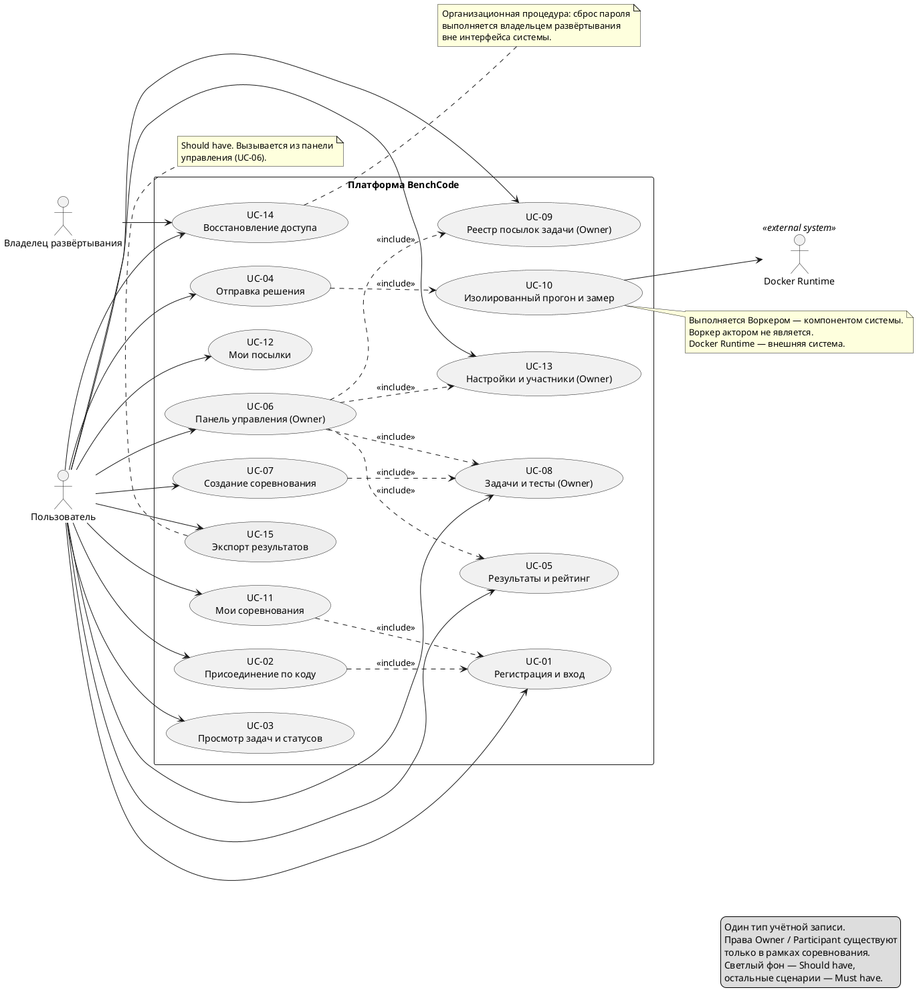
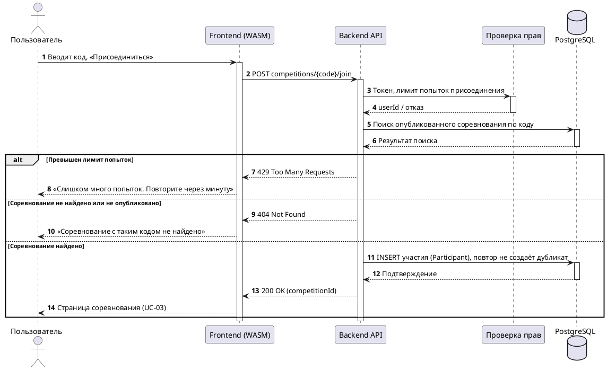
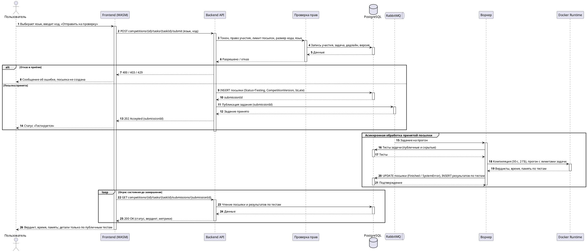
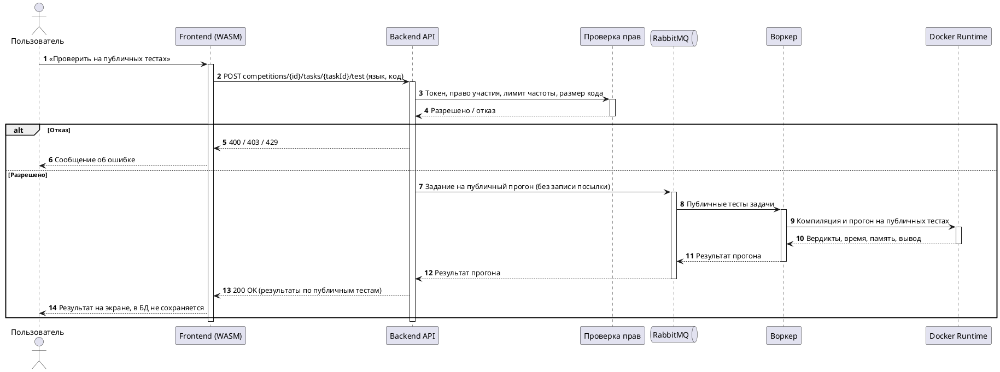
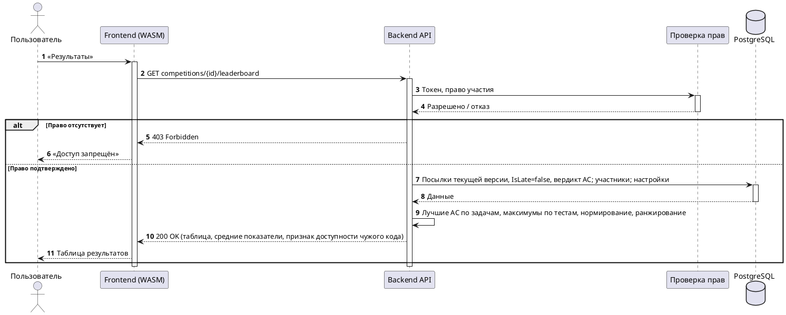
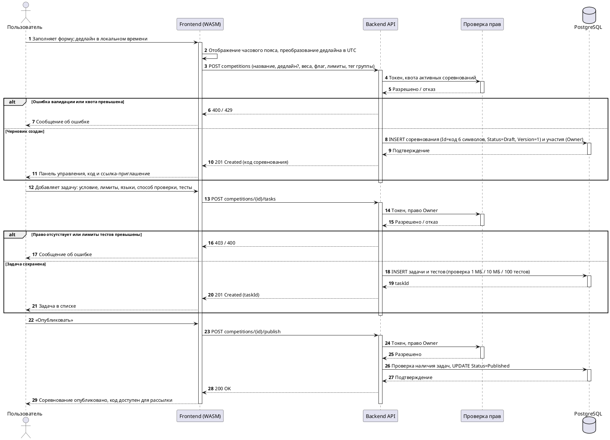
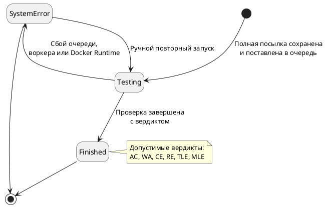
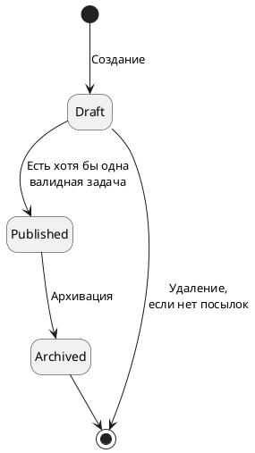

## 1. Use Case Diagram (PlantUML)

**Что исправлено относительно прежней версии**
- Один пользовательский актор вместо «Студента» и «Преподавателя»; сценарий выбора режима удалён.
- Добавлен UC-01 (регистрация и вход), которого не было на диаграмме.
- Ассоциации пользователя со всеми сценариями, включая создание соревнования и задач.
- `<<extend>>` от создания соревнования к «входу по паролю» заменён на `<<include>>` к сценариям управления; вход по мастер-паролю отсутствует.
- Воркер исключён из акторов; Docker Runtime обозначен как внешняя система.
- Добавлены UC-11…UC-15; приоритет Should выделен визуально.

---

## 2. Диаграммы последовательностей (PlantUML)

Общее для всех сценариев: каждый запрос содержит токен доступа; при недействительном токене возвращается 401 (в схемах не показан отдельно); время хранится в UTC; префикс API отсутствует.

### 2.1 Присоединение к соревнованию по коду (UC-02)

### 2.2 Полная отправка решения (UC-04, UC-10)

### 2.3 Прогон на публичных тестах (UC-04, альтернативный поток)

Публичный прогон выполняется синхронно: число тестов ограничено, повторы для замера не выполняются. Перевод на асинхронную схему — открытый пункт.

### 2.4 Таблица результатов (UC-05)

### 2.5 Создание соревнования и задачи (UC-07, UC-08)

Изменение задач, тестов, лимитов или весов у опубликованного соревнования с посылками увеличивает `Version`; в рейтинг попадают только посылки текущей версии (BR-19). Отдельного сценария перепроверки нет.

---

## 3. Диаграммы состояний

### 3.1 Жизненный цикл посылки

`SystemError` обозначает сбой платформы, а не вердикт пользовательского решения. При ручном повторном запуске посылка снова переходит в `Testing`.

### 3.2 Жизненный цикл соревнования

