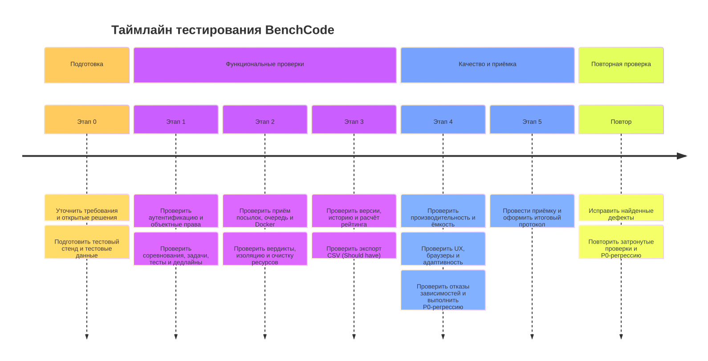

# План тестирования проекта BenchCode

**Версия:** 2.0  
**Статус:** рабочий план, согласованный с актуальными требованиями системы  
**Дата актуализации:** 2026-11-12

## 1. Введение

План определяет объём, стратегию, условия, этапы и критерии тестирования BenchCode — веб-системы соревнований по программированию с проверкой решений в изолированном окружении. План составлен по сценариям использования и трассировке требований в духе RUP; это рабочая структура проекта, а не заявление о сертификации по стандарту.

Документ проверяет требования из [Функциональных требований](../Функциональные%20требования.md), [Нефункциональных требований](../Нефункциональные%20требования.md), [MoSCoW-приоритизации](../Приоритизация%20по%20MoSCoW.md), [диаграммы классов](../classDiagram.mermaid) и [C4-модели](../c4.c4). Методы и техники описаны в [Способах тестирования](./Способы_тестирования.md); обработка исключений — в [соответствующем документе](./Обработка_исключительных_ситуаций.md).

## 2. Цели и критерии успеха

Цели тестирования:

1. Подтвердить сквозной контур: регистрация → создание соревнования и задач → присоединение → отправка решения → изолированная проверка → результаты.
2. Проверить права `Owner` / `Participant` и защиту персональных данных, исходного кода и скрытых тестов.
3. Подтвердить корректность вердиктов, метрик, версионирования, дедлайна и рейтинга.
4. Проверить безопасность и ограничение среды исполнения, включая классификацию инфраструктурных сбоев.
5. Измерить утверждённые пороги NFR на воспроизводимой конфигурации.
6. Обеспечить трассируемость требований к тестам и результатам.

Тестирование считается успешным для релизной оценки, когда выполнены критерии раздела 10. Успешный прогон тестов сам по себе не заменяет решения владельца продукта о релизе.

## 3. Объект и тестовые элементы

| Элемент | Состав |
|---|---|
| Клиент | Compose Multiplatform/WASM, статическая раздача файлов, интерфейс регистрации, соревнования, задачи, посылки и результатов |
| API | REST-эндпоинты аутентификации, соревнований, задач, тестов, посылок, рейтинга и экспорта |
| Серверная логика | Модули аутентификации и соревнований; авторизация на уровне объектов |
| Хранение | PostgreSQL: пользователи, соревнования, участия, задачи, тесты, посылки и результаты по тестам |
| Асинхронная обработка | RabbitMQ, воркер полной проверки и публичного прогона |
| Исполнение | Docker Runtime; образы для C++, Python, Java и C#; checker, лимиты и очистка контейнеров |
| Отчётность | Таблица результатов, история и реестр посылок; CSV-экспорт имеет приоритет Should have |

## 4. Объём тестирования

### 4.1 Включено

- UC-01…UC-14 и соответствующие бизнес-правила BR-01…BR-38.
- UC-15 (экспорт CSV) как Should have: тестируется после завершения Must-контуров; его отсутствие само по себе не блокирует MVP, если приоритет не изменён.
- Все NFR-001…NFR-007 как Must have.
- Ошибочные, граничные, альтернативные и восстановительные потоки, определённые исходными требованиями.
- Регрессия критических потоков после исправления дефектов и изменений связанных модулей.

### 4.2 Исключено из продуктовой приёмки MVP

- Функции, явно исключённые из объёма: глобальные роли «студент/преподаватель», мастер-пароль, каталог чужих соревнований, автоматический сброс пароля, подтверждение email, перепроверка старых посылок, мобильные приложения, ИИ-анализ, расширенная статистика, мобильный/кластерный/облачный деплой.
- Uptime/SLA, резервное копирование и восстановление после потери диска: NFR-007 прямо не задаёт эти требования.
- Норматив времени полного цикла посылки и первичной загрузки WASM: они исключены из NFR-002.
- Самостоятельная смена пароля в интерфейсе: вне MVP.

## 5. Стратегия и приоритеты

Тестирование выполняется итерационно, с приоритетом по риску и приоритету MoSCoW. Ошибки в безопасности, вердиктах, сохранности посылок и рейтинге проверяются раньше косметических улучшений.

| Приоритет | Смысл | Примеры |
|---|---|---|
| P0 — блокирующий | Риск утечки/несанкционированного доступа, потеря или подмена данных, выполнение кода вне ограничений, неверный базовый результат | Обход прав; утечка скрытого теста; неправильная классификация `SystemError`/`TLE`; потеря принятой посылки |
| P1 — высокий | Блокирует ключевой Must-сценарий или систематически нарушает бизнес-правило | Невозможно зарегистрироваться, опубликовать задачу, отправить посылку или получить корректный рейтинг |
| P2 — обычный | Частичная деградация с ограниченным охватом или обходным путём | Фильтр/пагинация, некритичная ошибка альтернативного потока |
| P3 — низкий | Косметический дефект без влияния на данные и завершение сценария | Незначительное визуальное несоответствие |

### 5.1 Уровни

- Модульные тесты — формулы, правила, валидация и преобразования.
- Компонентные и интеграционные — API с PostgreSQL, RabbitMQ и Docker; воркер с БД и средой исполнения.
- Системные/E2E — пользовательские пути через развернутую сборку.
- Приёмочные — контрольные UC и NFR на целевой конфигурации.
- Исследовательские/ручные — сообщения, доступность интерфейса, адаптивность и диагностика отказов.

Подробное распределение методов приведено в документе [Способы тестирования](./Способы_тестирования.md).

## 6. Матрица проверок и трассируемость

| Набор | Покрытие требований | Основные проверки |
|---|---|---|
| AUTH-01 | UC-01, BR-01…BR-06, BR-38, NFR-001 | Регистрация, нормализация и уникальность email, пароль/согласие, вход, блокировка, токены, ручное восстановление |
| ACCESS-01 | UC-02, UC-03, UC-06, BR-07…BR-14, BR-33 | Код, публикация, идемпотентное участие, `Owner`/`Participant`, проверки `401`/`403`/`404` на API |
| COMP-01 | UC-07, UC-08, UC-13, BR-15…BR-20, BR-25, BR-26, BR-29, BR-34 | Создание, черновик/публикация/архивация, квоты, задачи, тесты, checker, версия, удаление |
| DEADLINE-01 | UC-03…UC-05, UC-09, UC-13, UC-15, BR-16…BR-19, BR-32 | UTC и локальная зона; до/после дедлайна; метки late; исключение из рейтинга и CSV; просмотр кода |
| SUBMIT-01 | UC-04, UC-09, UC-12, BR-21…BR-24, BR-27…BR-30, BR-34 | Валидация кода и языка, публичный запуск, сохранение до очереди, статусы, история, фильтры, скрытые тесты, метрики |
| RUN-01 | UC-10, BR-25, BR-27…BR-29, BR-35, NFR-001, NFR-007 | C++/Python/Java/C#; `AC`/`WA`/`CE`/`RE`/`TLE`/`MLE`; `SystemError`; изоляция и очистка |
| SCORE-01 | UC-05, UC-09, UC-12, BR-18/19/30…BR-33, BR-36…BR-38 | Эталонный расчёт рейтинга, текущая версия, late, равные места, видимость чужого кода, история |
| HOME-01 | UC-11, BR-07/08/13/36 | Единый экран «Я организатор»/«Я участвую», фильтр группы, пустые состояния, создание/присоединение |
| EXPORT-01 | UC-15, BR-18/19/31 | CSV по текущей версии без late-посылок; ошибки и пустые данные; приоритет Should |
| PERF-01 | NFR-002, NFR-003 | Интерактивный p95 ≤ 1.5 с; чтение/API ≥ 30 RPS и p95 ≤ 300 мс |
| CAP-01 | NFR-005 | Хранение ≥ 50 000 посылок с результатами по тестам; лимиты кода, файлов, тестов и квот |
| UX-COMPAT-01 | NFR-004, NFR-006 | Единый экран решения, сообщения/статусы, браузеры с WasmGC, ширины 360–1920 px |
| FAIL-01 | UC-01…UC-15, NFR-007 | Недоступность БД, RabbitMQ, воркера, Docker; пустые ответы не маскируют сбой; очистка контейнеров |

Все Must и все NFR должны быть связаны минимум с одним тестом. Проверки более низкого уровня дополнительно трассируются к BR или сущности модели данных.

## 7. Ключевые тестовые сценарии

Ниже — минимальный контрольный набор для начала тестирования; полные шаги и данные оформляются в тест-кейсах набора.

| ID | Приоритет | Сценарий | Ожидаемый результат |
|---|---|---|---|
| TC-AUTH-01 | P1 | Зарегистрировать пользователя с корректными данными и согласием | Учётная запись создана; пароль хранится как хеш; выданы токены и открыт список соревнований |
| TC-AUTH-02 | P1 | Отправить неверные данные входа для существующего и несуществующего email | Одинаковое сообщение без раскрытия наличия учётной записи |
| TC-AUTH-03 | P0 | Выполнить 5 неудачных попыток в окне 15 минут и проверить следующую попытку | После достижения лимита включена временная блокировка; следующая попытка не проверяет пароль до окончания блокировки |
| TC-ACC-01 | P0 | Участник вызывает API управления чужим соревнованием с известным идентификатором | `403`; объект не читается и не изменяется |
| TC-ACC-02 | P1 | Повторно присоединиться к доступному соревнованию тем же кодом | Участие идемпотентно; дублирующей записи нет |
| TC-COMP-01 | P1 | Опубликовать пустой черновик, затем добавить валидную задачу и повторить | Первая публикация запрещена; после добавления валидной задачи статус становится `Published` |
| TC-COMP-02 | P1 | Изменить сравнимые параметры опубликованного соревнования | Версия увеличивается; прежние посылки сохраняются и не попадают в рейтинг текущей версии |
| TC-DEAD-01 | P1 | Отправить решение непосредственно до и после дедлайна | Поздняя посылка принята с меткой late и исключена из рейтинга/экспорта |
| TC-SUB-01 | P0 | Отправить полный корректный код | Сначала сохранена посылка `Testing`, затем отображён итог без перезагрузки |
| TC-SUB-02 | P1 | Запустить только публичные тесты | Результат возвращён клиенту; записи полной посылки в БД/реестре нет |
| TC-SEC-01 | P0 | Запросить скрытые тесты и детали скрытого `WA` участником | Возвращены только номер теста и вердикт; содержимое/эталон/diff не доступны |
| TC-RUN-01 | P0 | Проверить контролируемые программы для каждого вердикта | Вердикты соответствуют причине; ресурсы и контейнер очищены |
| TC-FAIL-01 | P0 | Остановить тестовый воркер после сохранения полной посылки | Посылка не теряется; сбой имеет статус `SystemError`, не `TLE`; доступна ручная обработка по требованиям |
| TC-SCORE-01 | P0 | Рассчитать рейтинг по фиксированной таблице посылок | Порядок, нормированные показатели и общее место совпадают с независимым расчётом BR-31 |
| TC-PERF-01 | P1 | Измерить чтение API на согласованном профиле нагрузки | Не менее 30 RPS и p95 ≤ 300 мс |
| TC-PERF-02 | P1 | Измерить ключевые действия UI в загруженном приложении | p95 ≤ 1.5 с; полный цикл проверки и первичная загрузка WASM не включены |
| TC-CAP-01 | P1 | Подготовить 50 000 посылок с результатами тестов и выполнить контрольные запросы | Данные читаются и сохраняются без потери целостности |
| TC-COMPAT-01 | P1 | Проверить интерфейс на согласованной матрице браузеров и ширин | Приложение работает при WasmGC; контент доступен в пределах 360–1920 px |

Для языковых образов, версии компиляторов, флаги, протокол чекера, повторяемость замеров и частоту опроса статусов исходные документы содержат открытые решения. До их согласования тестирование фиксирует фактическую конфигурацию, не подменяя её предположениями.

## 8. Тестовая среда и данные

### 8.1 Среда

Целевая среда по NFR: один хост Arch Linux, AMD Van Gogh (4 ядра/8 потоков), 16 ГБ RAM, NVMe 512 ГБ, Docker, .NET Aspire, PostgreSQL, RabbitMQ, один backend и статическая раздача frontend. Для прогонов зарезервированы 2 ядра; остальная нагрузка относится к API, БД и брокеру.

Тесты должны выполняться на отдельном тестовом развёртывании, не на продуктивных аккаунтах и данных. Если тестовый стенд отличается от целевого, различия и их влияние на измерения фиксируются в отчёте. Нагрузочные тесты не следует запускать одновременно с измерением задержек интерактивных операций, если сценарий явно не моделирует совместную нагрузку.

### 8.2 Данные

Подготовить минимум:

- двух обычных пользователей: создателя соревнования и участника; дополнительные аккаунты — для рейтинга и проверки чужих данных;
- черновое, опубликованное и архивированное соревнования; соревнование с дедлайном и без него;
- задачи с ExactText и CustomChecker, разрешёнными языками и смешанными публичными/скрытыми тестами;
- тестовые исходники для каждого поддерживаемого вердикта и языка;
- посылки разных версий, с дедлайном и после дедлайна, а также данные для равенства рейтинга;
- набор граничных объёмов и набор не менее 50 000 посылок для NFR-005.

Использовать синтетические персональные данные. В сценариях защиты скрытых тестов содержимое маркировать уникальными тестовыми значениями и проверять отсутствие их в ответах и журналах. Не использовать реальные пароли, действительные токены и продуктивные пользовательские данные.

## 9. Условия начала и приостановки

### 9.1 Начало

- Зафиксирована версия клиентской и серверной сборки и конфигурация Docker-образов.
- Доступны тестовый API, PostgreSQL, RabbitMQ, воркер и Docker Runtime.
- Утверждены используемые требования и перечень открытых вопросов, влияющих на критерии.
- Подготовлены тестовые аккаунты/данные; данные можно безопасно сбросить между наборами.
- Для нагрузочных и ресурсных проверок подтверждена изоляция стенда от продуктивной среды.

Если какая-либо зависимость недоступна, соответствующий набор получает статус **Blocked**, а не **Passed**.

### 9.2 Приостановка и возобновление

Приостановить затронутые тесты, если тестовая сборка нестабильна, недоступна обязательная зависимость, нарушена изоляция, возник риск повреждения данных или дефект блокирует достоверное продолжение.

Возобновить после устранения причины, фиксации новой версии и успешного smoke-теста на авторизации, чтении данных, постановке тестовой посылки и очистке её окружения.

## 10. Критерии завершения и релизная оценка

Тестирование завершено, когда:

- все предусмотренные P0-тесты пройдены;
- все Must-сценарии UC-01…UC-14 и все NFR имеют результат и трассировку;
- нет открытых критических/высоких дефектов в авторизации, скрытых тестах, изоляции, сохранности посылок, вердиктах и рейтинге;
- тесты `SystemError`, `TLE` и `MLE` подтверждают раздельную классификацию;
- контейнеры удаляются после прогона и осиротевшие контейнеры устраняются тестируемой процедурой;
- численные NFR проверены на зафиксированном профиле/окружении либо явно отмечены как блокированные с причиной;
- все оставшиеся дефекты, ограничения измерений и открытые решения внесены в отчёт.

Релиз не может считаться подтверждённым, если обнаружена утечка скрытого теста, обход авторизации, выполнение вне изоляции или потеря/подмена принятой посылки. Исключения по не-критическим дефектам требуют документированного решения владельца продукта.

## 11. Этапы работ и результаты

Календарные сроки и длительности не заданы; этапы привязаны к готовности компонентов и итерациям, а не к вымышленным датам.

| Этап | Работы | Выходной артефакт |
|---|---|---|
| 0. Подготовка | Уточнить открытые решения; настроить тестовую среду и данные; создать матрицу UC/BR/NFR | Зафиксированная версия требований и среды, трассировка |
| 1. Основа | Аутентификация, права, модель данных, создание соревнования/задач | Результаты AUTH-01, ACCESS-01, COMP-01 |
| 2. Проверка решений | Приём посылки, очередь, Docker, языки, вердикты, очистка | Результаты SUBMIT-01 и RUN-01 |
| 3. Рейтинг и история | Дедлайн, версии, leaderboard, списки и карточки посылок | Результаты DEADLINE-01 и SCORE-01 |
| 4. Нефункциональные | Производительность, объём, совместимость, удобство и отказы | Отчёты PERF-01, CAP-01, UX-COMPAT-01, FAIL-01 |
| 5. Приёмка | Smoke и P0-регрессия, сверка открытых дефектов, контрольная демонстрация | Итоговый протокол и решение о готовности |

### 11.1 Диаграммы процесса и таймлайн

Диаграммы показывают порядок и контрольные точки этапов. Календарные сроки в плане не заданы, поэтому таймлайн отражает последовательность работ, а не даты или длительность.

**Блок-схема процесса тестирования:**

[Исходник блок-схемы Mermaid](./План_тестирования_BenchCode.mermaid)

**Таймлайн этапов тестирования:**

[Исходник таймлайна Mermaid](./Таймлайн_тестирования_BenchCode.mermaid)

## 12. Ресурсы и ответственность

Фактический состав команды не задан; ниже перечислены необходимые функции, а не закреплённые за конкретными лицами должности.

| Функция | Ответственность |
|---|---|
| Координатор тестирования | План, приоритеты, трассировка, отчёт и контроль блокеров |
| QA/тестировщик | Подготовка/выполнение тест-кейсов, фиксация доказательств, регрессия |
| Разработчик backend/frontend | Анализ требований, устранение дефектов, модульные и компонентные проверки |
| Ответственный за среду | Конфигурация PostgreSQL/RabbitMQ/Docker, изоляция тестового стенда, очистка |
| Владелец продукта/требований | Разрешение открытых вопросов и принятие остаточного риска |

Среда требует тестового Linux-хоста с Docker и отдельного управляемого набора данных. Нагрузочное измерение должно иметь фиксированные параметры запуска и результаты, пригодные для повторного сравнения.

## 13. Основные риски и меры

| Риск | Последствие | Мера |
|---|---|---|
| Открытые решения по чекеру, образам, флагам и повторяемости | Проверки разных запусков несопоставимы | Фиксировать фактическую конфигурацию; согласовать её до финальной приёмки |
| Общий хост и шум времени/памяти | Разброс результатов программ | Фиксировать нагрузку и версии образов; не вводить неутверждённый допуск разброса |
| Сбой RabbitMQ/воркера/Docker | Потеря или неверная классификация посылки | Отдельно проверять сохранение перед очередью и `SystemError` |
| Тестирование на общем или продуктивном Docker-хосте | Риск данным и изоляции | Проводить проверки только на изолированном стенде с безопасными тестовыми программами |
| Недостаточное покрытие скрытых тестов | Утечка эталона или входа | Проверять серверные ответы, сообщения участника и журналы для каждого пути отображения результата |
| Отсутствие резервного копирования | Невосстановимая потеря БД при отказе диска | Зафиксировать как принятый риск MVP; не включать неподдерживаемый критерий восстановления |
| Опрос статусов не имеет заданного интервала | Читающая нагрузка отличается между тестами | Зафиксировать текущую конфигурацию клиента; включить интервал в согласование NFR |

## 14. Отчётность

Отчёт по итерации содержит:

- сборку, конфигурацию и даты фактических прогонов;
- процент/количество Passed, Failed, Blocked и Not run с перечнем тестов;
- дефекты по серьёзности и приоритету, ссылки на UC/BR/NFR;
- результаты измерений с параметрами нагрузки и стенда;
- подтверждения исправления и регрессионные прогоны;
- ограничения среды, отклонения от плана и нерешённые открытые вопросы;
- рекомендацию о готовности без скрытия известных рисков.

В материалы отчёта нельзя включать реальные пароли, токены, чужие исходники или содержимое скрытых тестов.
