# Архитектура системы BenchCode

**Версия:** 2.0  
**Дата:** 2026-11-12

Документ представляет архитектуру BenchCode для обсуждения и демонстрации заказчику: основные компоненты и связи, модель данных, ключевые взаимодействия, жизненный цикл сущностей и устройство пользовательского интерфейса.

## Содержание

- [1. Архитектурный обзор](#section-1)
- [2. C4-модель](#section-2)
- [3. Диаграмма классов](#section-3)
- [4. Диаграммы взаимодействия](#section-4)
- [5. Диаграммы состояний](#section-5)
- [6. Проектирование интерфейса](#section-6)
- [7. Основные архитектурные решения](#section-7)

---

<a id="section-1"></a>

## 1. Архитектурный обзор

BenchCode — веб-платформа для проведения соревнований по программированию и автоматической проверки решений. Пользователь работает через браузер. Серверное приложение предоставляет REST API, управляет соревнованиями и учетными записями, а выполнение пользовательского кода вынесено в асинхронный контур с очередью сообщений, воркером и Docker Runtime.

| Часть системы | Назначение | Технологии / ответственность |
|---|---|---|
| Веб-клиент | Регистрация, соревнования, задачи, отправка решений и просмотр результатов | Kotlin, Compose Multiplatform/WASM |
| API и серверные модули | Аутентификация, проверка прав, управление соревнованиями и прием посылок | .NET, REST API, Aspire |
| Хранилище | Пользователи, соревнования, участия, задачи, тесты, посылки и результаты | PostgreSQL |
| Асинхронная обработка | Буферизация полной посылки и публичного прогона, передача задания воркеру | RabbitMQ |
| Исполнительная среда | Компиляция и запуск решений в изолированных контейнерах | Воркер, Docker Runtime |

В системе один тип учётной записи. Права `Owner` и `Participant` относятся к конкретному соревнованию: создатель получает `Owner`, а присоединившийся пользователь — `Participant`. Пользователь может быть организатором одного соревнования и участником другого.

---

<a id="section-2"></a>

## 2. C4-модель

### 2.1 Контекст системы

Пользователь взаимодействует с BenchCode через браузер. Docker Runtime — внешняя среда исполнения, используемая системой для изолированной компиляции и проверки программ.

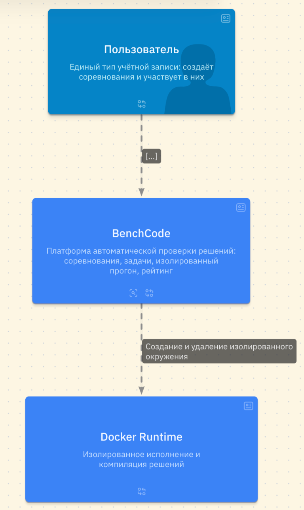

### 2.2 Контейнеры и компоненты

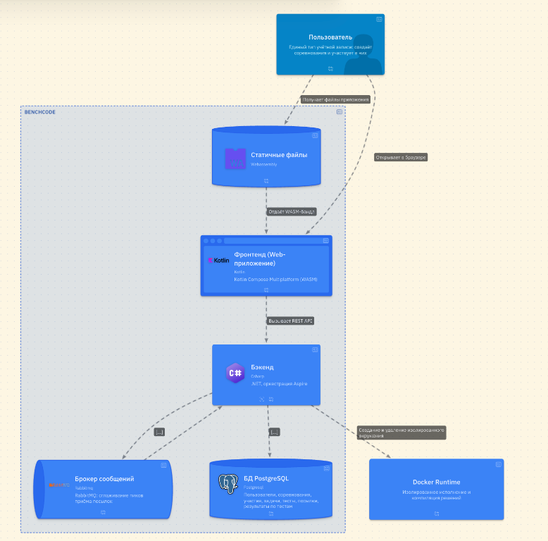

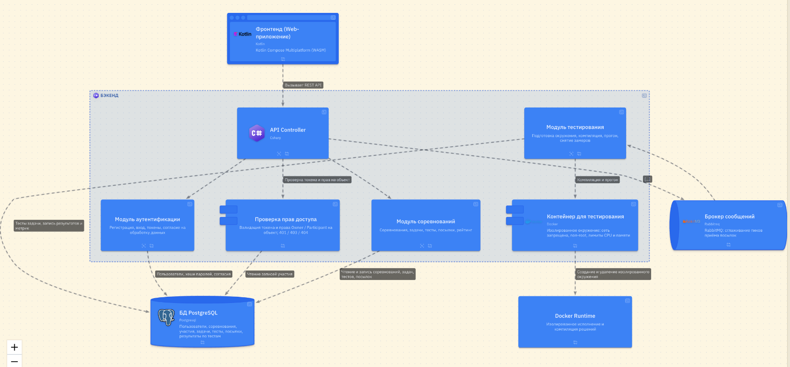

Ключевые компоненты backend: API Controller, проверка объектных прав, модуль аутентификации, модуль соревнований и модуль тестирования. PostgreSQL хранит продуктовые данные, RabbitMQ сглаживает пики посылок, Docker Runtime исполняет пользовательский код.

### 2.3 Контракты API и внутренние операции

Скриншоты ниже детализируют API и операции модулей; полная текстовая C4-модель приведена далее.

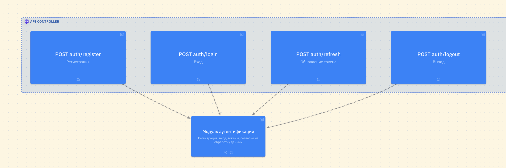

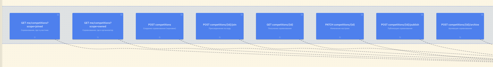

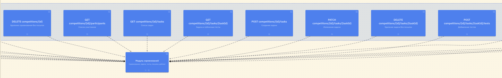

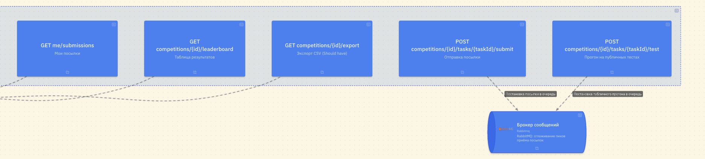

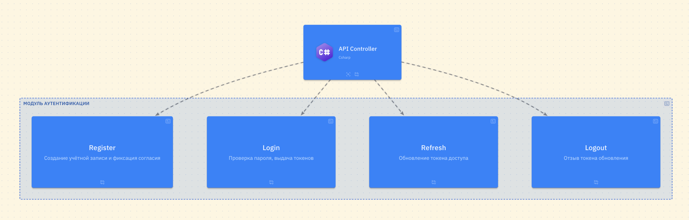

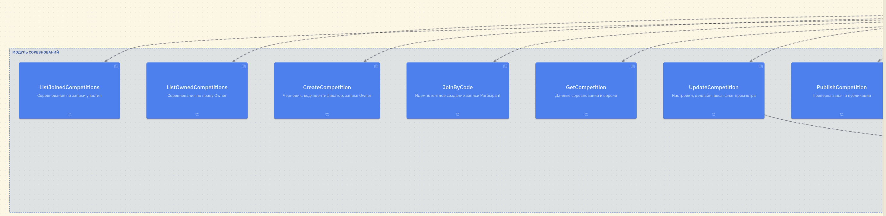

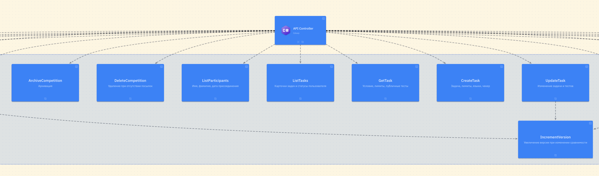

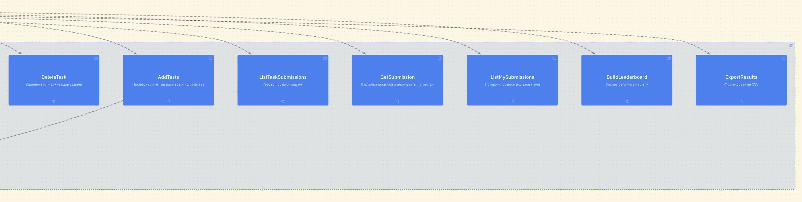

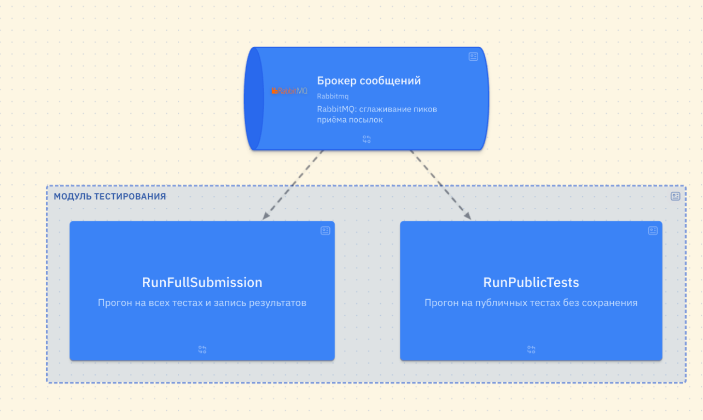

### 2.4 Исходный код C4-модели

Код модели хранится также в [c4.c4](./c4.c4).

```c4
specification {
  element actor {
    style { shape person color secondary }
  }
  element system
  element container {
    style { shape rectangle }
  }
  element component {
    style { shape component }
  }
  element endpoint {
    style { shape rectangle size large }
  }
  element operation {
    style { shape rectangle size large }
  }
}

model {
  user = actor 'Пользователь' {
    description 'Единый тип учётной записи: создаёт соревнования и участвует в них'
  }

  dockerRuntime = system 'Docker Runtime' {
    description 'Изолированное исполнение и компиляция решений'
  }

  benchCode = system 'BenchCode' {
    description 'Платформа автоматической проверки решений: соревнования, задачи, изолированный прогон, рейтинг'

    staticContent = component 'Статичные файлы' {
      style { icon tech:webassembly shape storage }
    }

    ui = container 'Фронтенд (Web-приложение)' {
      description 'Kotlin Compose Multiplatform (WASM)'
      style { icon tech:kotlin shape browser }
    }

    backend = container 'Бэкенд' {
      description '.NET, оркестрация Aspire'
      style { icon tech:csharp }

      apiController = container 'API Controller' {
        style { icon tech:csharp }
        epRegister = endpoint 'POST auth/register' 'Регистрация'
        epLogin = endpoint 'POST auth/login' 'Вход'
        epRefresh = endpoint 'POST auth/refresh' 'Обновление токена'
        epLogout = endpoint 'POST auth/logout' 'Выход'
        epMyJoined = endpoint 'GET me/competitions?scope=joined' 'Соревнования, где я участник'
        epMyOwned = endpoint 'GET me/competitions?scope=owned' 'Соревнования, где я организатор'
        epCreateCompetition = endpoint 'POST competitions' 'Создание соревнования (черновик)'
        epJoin = endpoint 'POST competitions/{id}/join' 'Присоединение по коду'
        epGetCompetition = endpoint 'GET competitions/{id}' 'Получение соревнования'
        epUpdateCompetition = endpoint 'PATCH competitions/{id}' 'Изменение настроек'
        epPublish = endpoint 'POST competitions/{id}/publish' 'Публикация соревнования'
        epArchive = endpoint 'POST competitions/{id}/archive' 'Архивация соревнования'
        epDeleteCompetition = endpoint 'DELETE competitions/{id}' 'Удаление соревнования без посылок'
        epParticipants = endpoint 'GET competitions/{id}/participants' 'Список участников'
        epGetTasks = endpoint 'GET competitions/{id}/tasks' 'Список задач'
        epGetTask = endpoint 'GET competitions/{id}/tasks/{taskId}' 'Задача и публичные тесты'
        epCreateTask = endpoint 'POST competitions/{id}/tasks' 'Создание задачи'
        epUpdateTask = endpoint 'PATCH competitions/{id}/tasks/{taskId}' 'Изменение задачи'
        epDeleteTask = endpoint 'DELETE competitions/{id}/tasks/{taskId}' 'Удаление задачи без посылок'
        epAddTests = endpoint 'POST competitions/{id}/tasks/{taskId}/tests' 'Добавление тестов'
        epSubmit = endpoint 'POST competitions/{id}/tasks/{taskId}/submit' 'Отправка посылки'
        epTest = endpoint 'POST competitions/{id}/tasks/{taskId}/test' 'Прогон на публичных тестах'
        epSubmissions = endpoint 'GET competitions/{id}/tasks/{taskId}/submissions' 'Реестр посылок задачи'
        epSubmission = endpoint 'GET competitions/{id}/tasks/{taskId}/submissions/{submissionId}' 'Карточка посылки'
        epMySubmissions = endpoint 'GET me/submissions' 'Мои посылки'
        epLeaderboard = endpoint 'GET competitions/{id}/leaderboard' 'Таблица результатов'
        epExport = endpoint 'GET competitions/{id}/export' 'Экспорт CSV (Should have)'
      }

      authorization = component 'Проверка прав доступа' {
        description 'Валидация токена и права Owner / Participant на объект; 401 / 403 / 404'
      }

      competitionController = container 'Модуль соревнований' {
        description 'Соревнования, задачи, тесты, посылки, рейтинг'
        opMyJoined = operation 'ListJoinedCompetitions' 'Соревнования по записи участия'
        opMyOwned = operation 'ListOwnedCompetitions' 'Соревнования по праву Owner'
        opCreate = operation 'CreateCompetition' 'Черновик, код-идентификатор, запись Owner'
        opJoin = operation 'JoinByCode' 'Идемпотентное создание записи Participant'
        opGet = operation 'GetCompetition' 'Данные соревнования и версия'
        opUpdate = operation 'UpdateCompetition' 'Настройки, дедлайн, веса, флаг просмотра'
        opPublish = operation 'PublishCompetition' 'Проверка задач и публикация'
        opArchive = operation 'ArchiveCompetition' 'Архивация'
        opDelete = operation 'DeleteCompetition' 'Удаление при отсутствии посылок'
        opParticipants = operation 'ListParticipants' 'Имя, фамилия, дата присоединения'
        opTasks = operation 'ListTasks' 'Карточки задач и статусы пользователя'
        opTask = operation 'GetTask' 'Условие, лимиты, публичные тесты'
        opCreateTask = operation 'CreateTask' 'Задача, лимиты, языки, чекер'
        opUpdateTask = operation 'UpdateTask' 'Изменение задачи и тестов'
        opDeleteTask = operation 'DeleteTask' 'Удаление или архивация задачи'
        opAddTests = operation 'AddTests' 'Проверка лимитов размера и количества'
        opVersion = operation 'IncrementVersion' 'Увеличение версии при изменении сравнимости'
        opSubmissions = operation 'ListTaskSubmissions' 'Реестр посылок задачи'
        opSubmission = operation 'GetSubmission' 'Карточка посылки и результаты по тестам'
        opMySubmissions = operation 'ListMySubmissions' 'История посылок пользователя'
        opLeaderboard = operation 'BuildLeaderboard' 'Расчёт рейтинга на лету'
        opExport = operation 'ExportResults' 'Формирование CSV'
      }

      authenticationController = container 'Модуль аутентификации' {
        description 'Регистрация, вход, токены, согласие на обработку данных'
        opRegister = operation 'Register' 'Создание учётной записи и фиксация согласия'
        opLogin = operation 'Login' 'Проверка пароля, выдача токенов'
        opRefresh = operation 'Refresh' 'Обновление токена доступа'
        opLogout = operation 'Logout' 'Отзыв токена обновления'
      }

      testingController = container 'Модуль тестирования' {
        description 'Подготовка окружения, компиляция, прогон, снятие замеров'
        opFullRun = operation 'RunFullSubmission' 'Прогон на всех тестах и запись результатов'
        opPublicRun = operation 'RunPublicTests' 'Прогон на публичных тестах без сохранения'
      }

      testingContainer = component 'Контейнер для тестирования' {
        description 'Изолированное окружение: сеть запрещена, non-root, лимиты CPU и памяти'
        style { icon tech:docker }
      }
    }

    messageBroker = component 'Брокер сообщений' {
      description 'RabbitMQ: сглаживание пиков приёма посылок'
      style { icon tech:rabbitmq shape queue }
    }

    database = container 'БД PostgreSQL' {
      description 'Пользователи, соревнования, участия, задачи, тесты, посылки, результаты по тестам'
      style { icon tech:postgresql shape storage }
    }
  }

  user -> benchCode.ui 'Открывает в браузере'
  user -> benchCode.staticContent 'Получает файлы приложения'
  benchCode.staticContent -> benchCode.ui 'Отдаёт WASM-бандл'
  benchCode.ui -> benchCode.backend.apiController 'Вызывает REST API'

  benchCode.backend.apiController -> benchCode.backend.authorization 'Проверка токена и прав на объект'
  benchCode.backend.authorization -> benchCode.database 'Чтение записей участия'

  benchCode.backend.apiController.epRegister -> benchCode.backend.authenticationController.opRegister
  benchCode.backend.apiController.epLogin -> benchCode.backend.authenticationController.opLogin
  benchCode.backend.apiController.epRefresh -> benchCode.backend.authenticationController.opRefresh
  benchCode.backend.apiController.epLogout -> benchCode.backend.authenticationController.opLogout
  benchCode.backend.authenticationController -> benchCode.database 'Пользователи, хеши паролей, согласия'

  benchCode.backend.apiController.epMyJoined -> benchCode.backend.competitionController.opMyJoined
  benchCode.backend.apiController.epMyOwned -> benchCode.backend.competitionController.opMyOwned
  benchCode.backend.apiController.epCreateCompetition -> benchCode.backend.competitionController.opCreate
  benchCode.backend.apiController.epJoin -> benchCode.backend.competitionController.opJoin
  benchCode.backend.apiController.epGetCompetition -> benchCode.backend.competitionController.opGet
  benchCode.backend.apiController.epUpdateCompetition -> benchCode.backend.competitionController.opUpdate
  benchCode.backend.apiController.epPublish -> benchCode.backend.competitionController.opPublish
  benchCode.backend.apiController.epArchive -> benchCode.backend.competitionController.opArchive
  benchCode.backend.apiController.epDeleteCompetition -> benchCode.backend.competitionController.opDelete
  benchCode.backend.apiController.epParticipants -> benchCode.backend.competitionController.opParticipants
  benchCode.backend.apiController.epGetTasks -> benchCode.backend.competitionController.opTasks
  benchCode.backend.apiController.epGetTask -> benchCode.backend.competitionController.opTask
  benchCode.backend.apiController.epCreateTask -> benchCode.backend.competitionController.opCreateTask
  benchCode.backend.apiController.epUpdateTask -> benchCode.backend.competitionController.opUpdateTask
  benchCode.backend.apiController.epDeleteTask -> benchCode.backend.competitionController.opDeleteTask
  benchCode.backend.apiController.epAddTests -> benchCode.backend.competitionController.opAddTests
  benchCode.backend.apiController.epSubmissions -> benchCode.backend.competitionController.opSubmissions
  benchCode.backend.apiController.epSubmission -> benchCode.backend.competitionController.opSubmission
  benchCode.backend.apiController.epMySubmissions -> benchCode.backend.competitionController.opMySubmissions
  benchCode.backend.apiController.epLeaderboard -> benchCode.backend.competitionController.opLeaderboard
  benchCode.backend.apiController.epExport -> benchCode.backend.competitionController.opExport

  benchCode.backend.competitionController.opUpdate -> benchCode.backend.competitionController.opVersion
  benchCode.backend.competitionController.opUpdateTask -> benchCode.backend.competitionController.opVersion
  benchCode.backend.competitionController.opAddTests -> benchCode.backend.competitionController.opVersion
  benchCode.backend.competitionController -> benchCode.database 'Чтение и запись соревнований, задач, тестов, посылок'

  benchCode.backend.apiController.epSubmit -> benchCode.messageBroker 'Постановка посылки в очередь'
  benchCode.backend.apiController.epTest -> benchCode.messageBroker 'Постановка публичного прогона в очередь'
  benchCode.messageBroker -> benchCode.backend.testingController.opFullRun
  benchCode.messageBroker -> benchCode.backend.testingController.opPublicRun
  benchCode.backend.testingController -> benchCode.database 'Тесты задачи, запись результатов и метрик'
  benchCode.backend.testingController -> benchCode.backend.testingContainer 'Компиляция и прогон'
  benchCode.backend.testingContainer -> dockerRuntime 'Создание и удаление изолированного окружения'
}

views {
  view contextView {
    title 'Context'
    include user, benchCode, dockerRuntime
  }
  view containerView of benchCode {
    title 'Containers'
    include *
  }
  view backendView of benchCode.backend {
    title 'Backend'
    include *
  }
  view apiControllerView of benchCode.backend.apiController {
    title 'ApiController'
    include *
  }
  view competitionControllerView of benchCode.backend.competitionController {
    title 'CompetitionController'
    include *
  }
  view authenticationControllerView of benchCode.backend.authenticationController {
    title 'AuthenticationController'
    include *
  }
  view testingControllerView of benchCode.backend.testingController {
    title 'TestingController'
    include *
  }
}
```

---

<a id="section-3"></a>

## 3. Диаграмма классов

Диаграмма показывает основные сущности, их связи и перечисления. Пользователь связан с соревнованиями как создатель и через записи участия; посылка хранит автора, задачу, версию соревнования и результаты прогонов.


Исходный Mermaid-код диаграммы хранится в [classDiagram.mermaid](./classDiagram.mermaid).

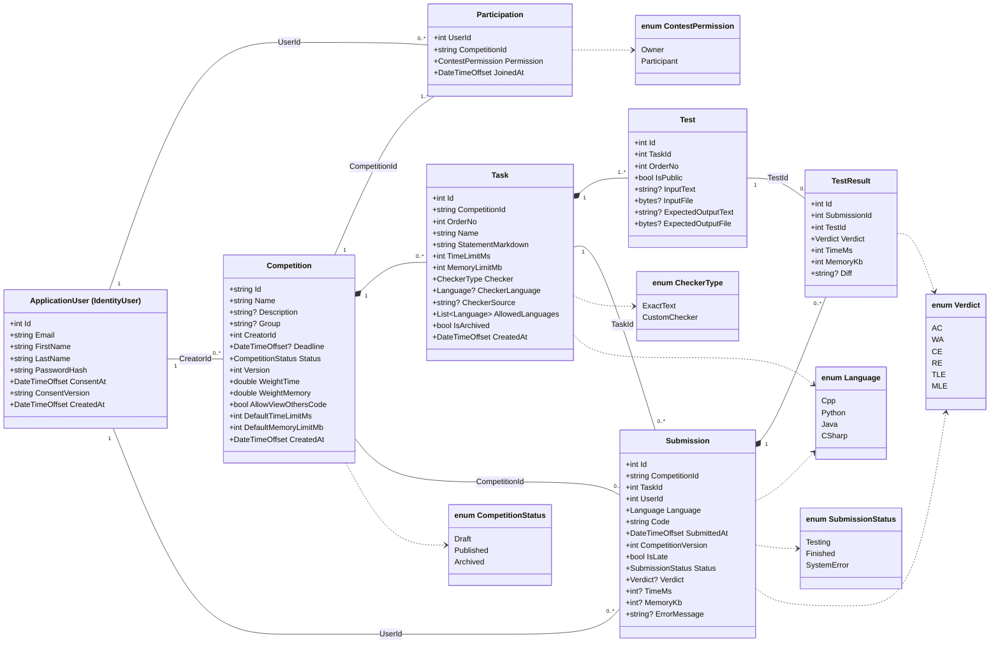

---

<a id="section-4"></a>

## 4. Диаграммы взаимодействия

### 4.1 Основные пользовательские сценарии

Диаграмма вариантов использования показывает действия единого пользователя, организатора в рамках принадлежащего ему соревнования и внешнего Docker Runtime.

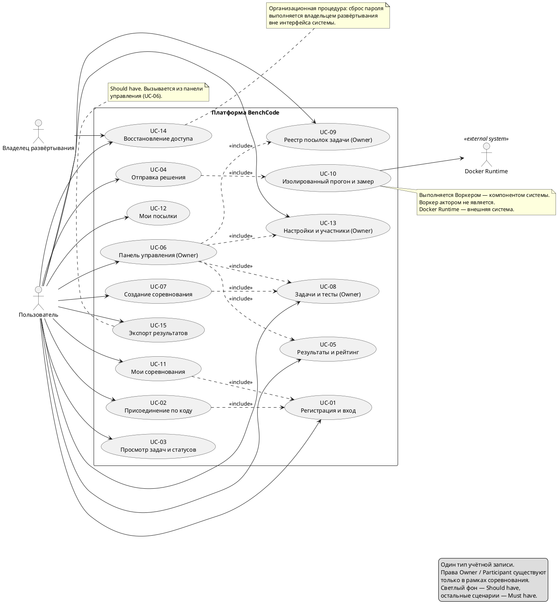

### 4.2 Присоединение к соревнованию

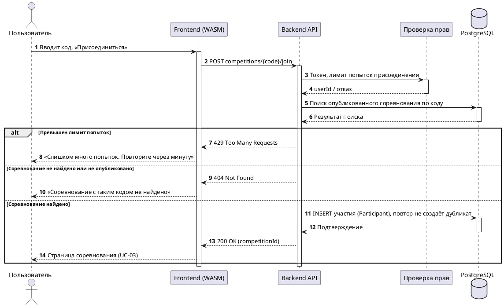

### 4.3 Создание и публикация соревнования

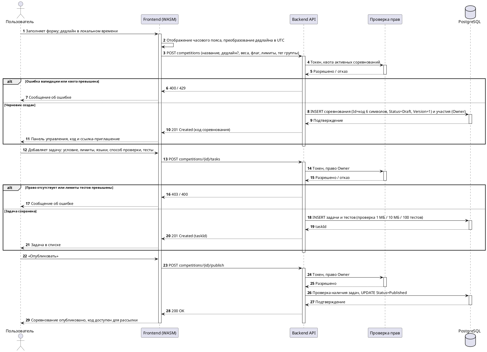

### 4.4 Полная отправка и проверка решения

Полная посылка сохраняется до отправки задания в очередь. Воркер получает задачу из RabbitMQ, запускает проверку в Docker Runtime и записывает результат; клиент получает актуальное состояние посылки через API.

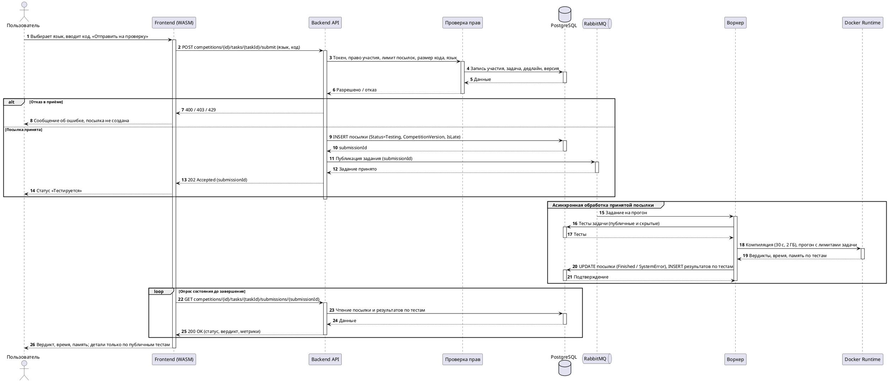

### 4.5 Публичный прогон

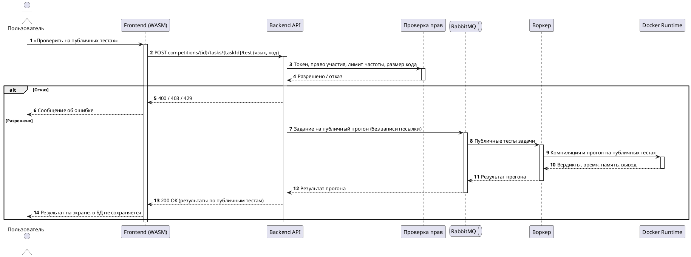

### 4.6 Получение таблицы результатов

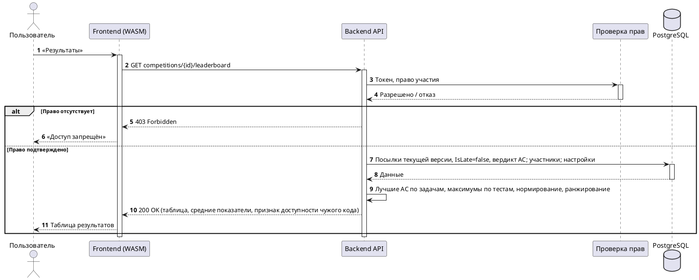

---

<a id="section-5"></a>

## 5. Диаграммы состояний

### 5.1 Жизненный цикл посылки

`SystemError` отделён от вердиктов решения: это отказ инфраструктуры, а не ошибка программы участника. При ручном повторном запуске посылка возвращается в `Testing`.

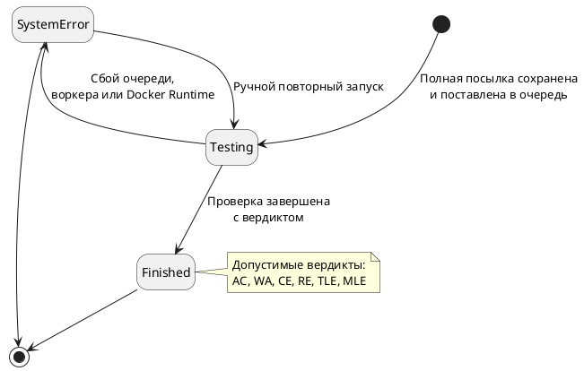

### 5.2 Жизненный цикл соревнования

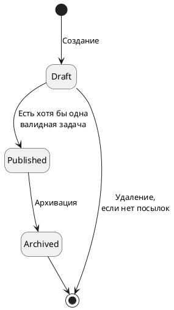

---

<a id="section-6"></a>

## 6. Проектирование интерфейса

Интерфейс построен как единое веб-приложение. Пользователь видит свои соревнования в двух контекстах — организует и участвует; отдельные аккаунты или режимы входа для «студента» и «преподавателя» не требуются.

### 6.1 Карта экранов

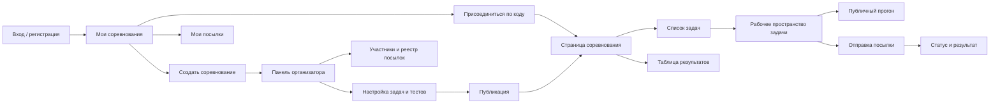

### 6.2 Основные экраны

| Экран | Содержание и действия | Контекст доступа |
|---|---|---|
| Вход / регистрация | Создание аккаунта или вход; после успеха открывается список соревнований | Пользователь |
| Мои соревнования | Разделение на «Я организатор» и «Я участвую», фильтр по тегу группы; действия «Создать» и «Присоединиться по коду» | Авторизованный пользователь |
| Создание и панель организатора | Черновик соревнования, параметры, код-приглашение, список участников, управление задачами и публикацией | `Owner` |
| Страница соревнования | Название, описание, дедлайн, версия, задачи и персональные статусы решений | `Owner` или `Participant` |
| Рабочее пространство задачи | Условие, лимиты, публичные примеры, выбор разрешённого языка, текстовый редактор, запуск публичного прогона и отправка | Участник соревнования |
| Карточка посылки | Статус, вердикт, время и память; компиляторная диагностика при `CE`; подробности по тестам согласно их видимости | Автор; организатор — в пределах прав |
| Таблица результатов | Место, решённые задачи, показатели времени и памяти; доступность чужого кода определяется правилами соревнования | Участник или организатор |
| История / реестр посылок | Фильтры и карточки посылок; в истории видны версия соревнования и метка опоздания | Пользователь видит свои посылки; `Owner` — реестр соревнования |

### 6.3 Поведение интерфейса при отправке решения

1. Пользователь выбирает язык из разрешённых для задачи и вводит исходный код.
2. Публичный прогон возвращает результат для отображения и не создаёт полную посылку.
3. При полной отправке интерфейс подтверждает приём и показывает «Тестируется».
4. После завершения отображаются вердикт и метрики; системный сбой визуально отделён от вердикта решения.
5. Скрытые входные данные, эталонные ответы и различия вывода не показываются участнику.

Схема основана на актуальных сценариях проекта; старые предложения о каталоге чужих соревнований, глобальном выборе роли и дополнительных полях регистрации в интерфейс не включены.

---

<a id="section-7"></a>

## 7. Основные архитектурные решения

- Один тип учётной записи; `Owner` и `Participant` — права в рамках соревнования.
- Разделение клиентской части, API, хранения данных и асинхронного исполнения пользовательского кода.
- PostgreSQL — хранилище соревнований, задач, тестов, пользователей, посылок и результатов; RabbitMQ — очередь заданий воркеру.
- Публичные прогоны отделены от полных посылок, сохраняемых в истории.
- Состояния `Testing`, `Finished`, `SystemError` согласованы между моделью данных и взаимодействием компонентов.
- Изменения сравнимых параметров соревнования версионируются; рейтинг рассчитывается для текущей версии.

### Исходные материалы

- [C4-модель](./c4.c4)
- [Диаграмма классов (Mermaid)](./classDiagram.mermaid) и [рендер диаграммы](./competition_participation.svg)
- [Диаграммы PlantUML](./PlantUML.md)
- [Функциональные сценарии](./Функциональные%20требования.md) и [нефункциональные характеристики](./Нефункциональные%20требования.md) — справочные материалы, не дублируемые в этом документе
