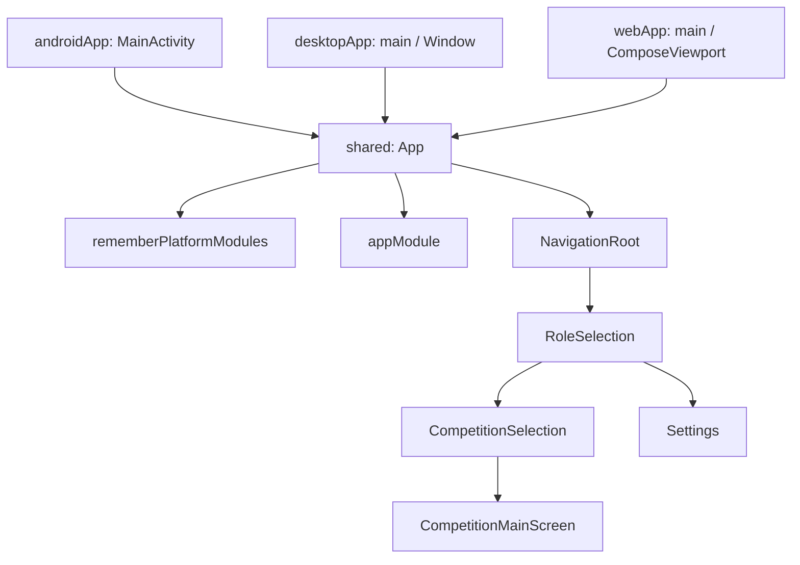
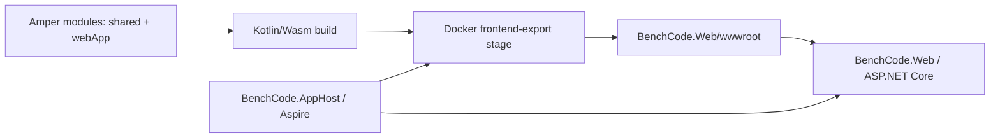

# Архитектура ComposeWebApp

## Границы приложения

`BenchCode.ComposeWebApp/project.yaml` описывает четыре Amper-модуля:

| Модуль | Назначение |
| --- | --- |
| `shared` | Общий Compose UI, маршруты, ViewModel, модели/репозитории, DI и платформенные реализации; собирается для Android, JVM и Wasm JS. |
| `androidApp` | Android entry point на `ComponentActivity`, который устанавливает Compose-контент `App()`. |
| `desktopApp` | JVM entry point, создающий Compose `Window` и вызывающий `App()`. |
| `webApp` | WebAssembly entry point на `ComposeViewport`, который также вызывает общий `App()`. |

Три app-модуля зависят от `shared`. Платформенно-независимое поведение и интерфейсы располагаются в `shared/src`, соответствующие реализации — в `shared/src@android`, `shared/src@jvm` и `shared/src@wasmJs`.

## Запуск и построение UI

На каждой платформе свой небольшой entry point вызывает общую composable-функцию `App()`. Она собирает платформенные Koin-модули через `rememberPlatformModules()`, добавляет `appModule`, задаёт `MaterialTheme` и отображает `NavigationRoot`.

## Навигация

`NavigationRoot` создаёт сериализуемый back stack с начальным маршрутом `SharedRoute.RoleSelection`. Он регистрирует `SharedRoute` и `StudentRoute` как `NavKey`, устанавливает декораторы сохранения состояния и передаёт отображение маршрутов в `koinEntryProvider`.

`appModule` связывает типы маршрутов с composable-экранами:

- `SharedRoute.RoleSelection` открывает выбор роли.
- `SharedRoute.Settings` открывает экран настроек.
- `StudentRoute.CompetitionSelection` открывает ввод кода соревнования.
- `StudentRoute.CompetitionMainScreen` передаёт `competitionId` в экран и его ViewModel.

В текущей реализации кнопка «Я студент» ведёт на выбор соревнования, а кнопка преподавателя пока не выполняет действие. Экран соревнования отображает переданный код; сетевой загрузки данных соревнования пока нет.

## Состояние, DI и локальные данные

`shared/src/di/AppModule.kt` регистрирует общие зависимости через Koin: `UserPreferencesRepository`, ViewModel и маршруты. Платформенные реализации `rememberPlatformModules()` создают `DataStore<Preferences>` с подходящим для платформы хранилищем.

`SettingsViewModel` получает сохранённый счётчик из `UserPreferencesRepository` как `StateFlow` и запускает инкремент в `viewModelScope`. Репозиторий хранит значения через Preferences DataStore. Пути хранения различаются: Android использует каталог файлов приложения, JVM — системный временный каталог, Wasm — браузерное локальное хранилище.

Контракты, зависящие от платформы, объявляются через `expect` в `shared/src` и реализуются в каталогах `src@<platform>`. Например, `getPlatform()`, `getBaseUrl()` и фабрика DataStore имеют платформенные реализации. `getBaseUrl()` сейчас возвращает localhost/эмуляторный адрес или origin браузера; наличие функции не означает, что сетевой API уже подключён к экранам.

## Сборочный путь web-клиента

Для разработки web-клиент можно запускать командой Kotlin Toolchain. Aspire использует отдельный контейнерный путь: Dockerfile строит `webApp` для Wasm JS, экспортирует файлы, затем .NET host отдаёт их как статические файлы. Схема:

Это описание фиксирует только интеграционные границы: каталог API/сервисов и поведение .NET host документируются отдельно.
