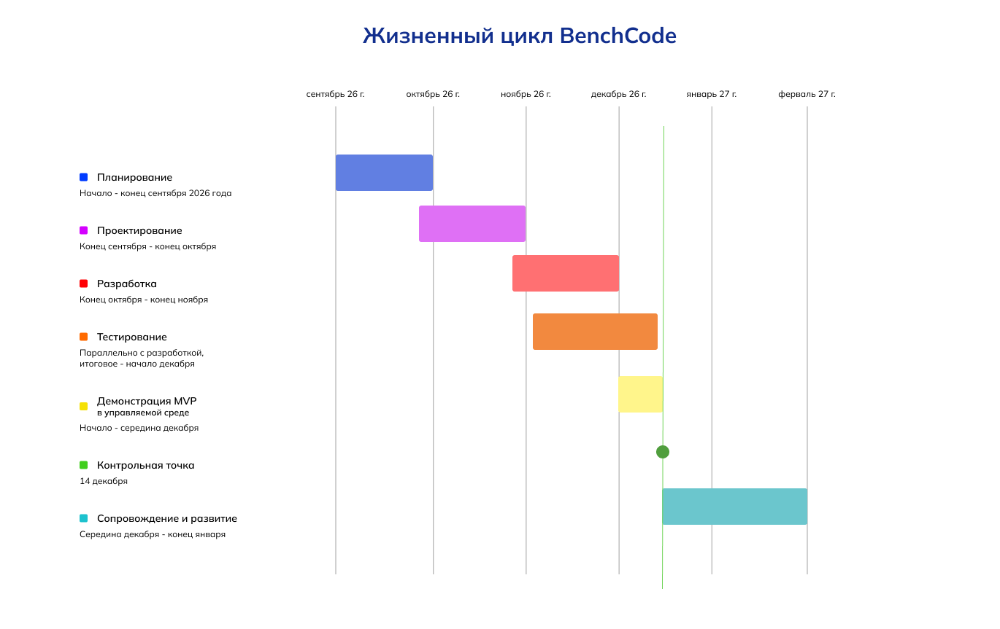

# Жизненный цикл проекта

Для разработки BenchCode используется **итеративная модель жизненного цикла на основе Agile**. Проект развивается последовательными итерациями, в рамках которых выполняются анализ потребностей, формирование и приоритизация требований, проектирование, разработка, тестирование и получение обратной связи. Результаты каждой итерации используются для планирования следующей.

В рамках проекта используется модель Double Diamond:

- **Discovery** - исследование потребностей пользователей, формирование и уточнение требований, анализ пользовательских сценариев и определение приоритетов;
- **Delivery** - проектирование, разработка, тестирование и выпуск реализованной функциональности.

| **№** | **Этап** | **Период** | **Ключевой результат** | **Ответственный** |
| --- | --- | --- | --- | --- |
| 1 | **Планирование** (Discovery) | 24–30 сен | Концепция, CJM, User Story, backlog с приоритетами MoSCoW, Use Case | Александра, вся команда |
| 2 | **Проектирование** | 28 сен – 14 окт | Архитектура, модель данных, API, прототипы UI, проверенный механизм замеров | Владислав, вся команда |
| 3 | **Итерационная разработка**(Delivery) | 15 окт – 30 ноя | Четыре итерации: MVP функции - метрики - сравнение и рейтинг - функции преподавателя | Владислав, вся команда |
| 4 | **Тестирование и обратная связь** | параллельно; итог 1–10 дек | Протоколы испытаний, матрица «требование - тест», актуальный backlog | Айдамир, вся команда |
| 5 | **Демонстрация MVP** | 11–17 дек | **Защита 17 декабря** | Вся команда |
| 6 | **Опытная эксплуатация и Discovery-2** | 18 дек – 28 февраля | Данные пилота, опрос аудитории backlog v2 | Александра, вся команда |
| 7 | **Итерации развития** | янв - мар 2027 | Релизы 2–4: дуэли 1:1, актор: староста, инструменты авторов задач | Вся команда |
| 8 | **ИИ-модуль** | с весны 2027 | Прототип рекомендаций по коду; автопроверка остаётся источником вердикта | Вся команда |

Модули распределяются на планировании каждой итерации, задача проходит ревью другого участника. В таблицах этапов «О» - один ответственный за результат, «У» - участвующие.

### Этап 1 · Планирование · Discovery  ·  24–30 сентября 2026

| **Задача** | **Артефакт** | **Кто (О - ответственный, У - участвует)** | **Срок** |
| --- | --- | --- | --- |
| Концепция проекта | Описание проекта, границы MVP | **О:** Александра  **У:** вся команда | 10 - 17 сентября |
| Исследование ЦА: интервью, карта эмпатии | Карта эмпатии | **О:** Александра  **У:** вся команда | 17-24 сентября |
| CJM текущего процесса и точки боли | CJM as-is | **О:** Александра  **У:** Айдамир | 17-24 сентября |
| Анализ конкурентов | Отчет | **О:** Владислав  **У:** Александра | 17-24 сентября |
| User Story, MoSCoW | User Story Map | **О:** Александра (US), Владислав (FR/NFR)  **У:** Айдамир | 24 сен - 1 окт |
| MoSCoW, требования FR/NFR |  |  |  |
| Use Case-диаграммы | Диаграммы для двух ролей | **О:** Владислав  **У:** Александра | до 30 сен |
| Риски, ЖЦ, среда управления (доска, репозиторий), backlog | Реестр рисков, этот документ, приоритизированный backlog | **О:** Александра  **У:** вся команда | до 30 сен |

**Ворота этапа:** backlog приоритизирован, объём MVP согласован, у каждого требования есть источник в исследовании пользователей.

### Этап 2 · Проектирование  Discovery - Delivery  ·  28 сентября - 14 октября

| **Задача** | **Артефакт** | **Кто (О - ответственный, У - участвует)** | **Срок / статус** |
| --- | --- | --- | --- |
| Архитектура: клиент, API, очередь проверки, воркеры, БД | Схема компонентов | **О:** Владислав  **У:** вся команда | 5 окт |
| Модель данных: запуск → решение → студент → группа → поток → соревнование → задача | ER-диаграмма | **О:** Владислав  **У:** Александра | 5 окт |
| **Spike:** изолированный запуск, замер времени и памяти, повторные прогоны | Прототип воркера, замеры разброса на эталонных программах | **О:** Владислав  **У:** Айдамир | 12 окт |
| API и алгоритмы агрегации и сравнения | Спецификация API, описание расчётов | **О:** Владислав  **У:** Айдамир (контракты для тестов) | 12 окт |
| Разработка UX/UI | Прототип в Фигме | **О:** Александра  **У:** Айдамир | 15 окт |
| Детализация US → Use Case с критериями приёмки; тест-стратегия | Use Case со сценариями, тест-план, набор эталонов | **О:** Александра (Use Case), Айдамир (тесты)  **У:** Владислав | 14 окт |

**Ворота этапа:** архитектура принята командой; spike показал, что замеры воспроизводимы в допустимых пределах (если нет, подход пересматривается до старта разработки); прототип показан пользователям.

### Этап 3 · Итерационная разработка   Delivery  ·  15 октября - 30 ноября

Необходимо получить рабочую систему по нарастающей, каждый раз с проверяемым результатом.

| **Итерация** | **Срок** | **Что делаем** | **User Story / требования** | **Критерий готовности** | **Кто** |
| --- | --- | --- | --- | --- | --- |
| **I1. Ядро** | 15–28 окт | Вход по ролям, создание задач (упрощённо), отправка решения, изолированный запуск, проверка корректности, вердикты | US-01, 02, 05, 13 (мин.) ·  FR-01, 02, 05, 07–09, 12  · NFR-03 | Студент сам отправляет программу и получает вердикт; чужой код выполняется в изоляции | **О:** Владислав  **У:** Александра (UI), Айдамир |
| **I2. Метрики** | 29 окт – 10 ноя | Время, память, ЦП по каждому тесту; несколько прогонов и медиана; сохранение и история запусков | US-03, 04, 06  ·  FR-10, 11, 13, 14  ·  NFR-02, 04 | Разброс повторных прогонов на эталонах в пределах цели (предложение: не более 5%); сохранённые результаты нельзя изменить | **О:** Владислав  **У:** Айдамир (замеры) |
| **I3. Сравнение и рейтинг** | 11–19 ноя | Агрегаты, сравнение со средним, рейтинг по задаче | US-07, 08  ·  FR-15–17 | Расчёты совпадают с эталоном, посчитанным вручную | **О:** Владислав  **У:** Александра, Айдамир |
| **I4. Преподаватель** | 20–30 ноя | Полное создание задач и тестов, соревнование, группы, статистика по группе, экспорт | US-13, 14, 16–19  ·  FR-02–04, 06, 17–19  ·  NFR-05 | Преподаватель сам проводит тестовое соревнование от создания до рейтинга; работают оба режима | **О:** Александра  **У:** Владислав, Айдамир |

### Этап 4 · Тестирование и обратная связь   Delivery  ·  параллельно разработке, итог 1–10 декабря

| **Задача** | **Артефакт** | **Кто (О - ответственный, У - участвует)** | **Срок / статус** |
| --- | --- | --- | --- |
| Тестирование внутри каждой итерации (функциональное, сценарии) | Тест-кейсы, отчёты о дефектах | **О:** Айдамир  **У:** автор модуля | каждая итерация |
| Автопроверка на эталонных программах: верная, неверная, зацикленная, с ошибкой компиляции, с превышением памяти | Набор эталонов, результаты прогонов | **О:** Айдамир  **У:** Владислав | с I1 |
| Точность и воспроизводимость метрик | Отчёт о разбросе замеров | **О:** Айдамир  **У:** Владислав | с I2 |
| Нагрузка: одновременная отправка решений всей группой (NFR-01) | Отчёт: время ожидания в очереди | **О:** Айдамир  **У:** Владислав | ноябрь |
| Юзабилити-проверка на студентах и преподавателе (NFR-06) | Протокол наблюдений | **О:** Александра  **У:** Айдамир | ноябрь – дек |
| Итоговое регрессионное и приёмочное тестирование | Протокол приёмки, матрица «требование → тест» | **О:** Айдамир  **У:** вся команда | 1–10 дек |
| Разбор дефектов и обратной связи | Обновлённый backlog | **О:** Александра | после каждой итерации |

### Этап 5 · Демонстрация MVP  Delivery  ·  11–17 декабря  ·  защита 17 декабря

| **Задача** | **Артефакт** | **Кто** | **Срок / статус** |
| --- | --- | --- | --- |
| Заморозка версии, релизная сборка | Тег в репозитории | **О:** Владислав | 11 дек |
| Стенд для демо и резервный сценарий | Развёрнутая среда, запись демо | **О:** Владислав  **У:** Айдамир | 12 дек |
| Комплексная проверка стенда по демо-сценарию: три сквозных прогона подряд | Чек-лист готовности | **О:** Айдамир | 13 дек |
| Документация: ТЗ по ГОСТ 34.602-2020, руководства студента и преподавателя, описание архитектуры | Комплект документов | **О:** Александра  **У:** Владислав (архитектура), Айдамир (тестирование) | 14 дек |
| Репетиция и защита | Выступление | **О:** вся команда | **15–17 дек** |

### Этап 6 · Опытная эксплуатация и Discovery -2   Развитие  ·  18 декабря – 31 января

**Цель:** проверить ценность на реальном использовании и открыть следующий цикл исследования.

| **Задача** | **Артефакт** | **Кто (О — ответственный, У — участвует)** | **Срок / статус** |
| --- | --- | --- | --- |
| Пилот на практике или мини-соревновании по СИАКОД | План пилота, отчёт пилота | **О:** Александра  **У:** вся команда | дек – янв |
| Метрики пилота: число запусков, доля самостоятельных отправок, время сбора результатов «до/после», разброс замеров | Таблица метрик «до/после» | **О:** Айдамир  **У:** Владислав | дек – янв |
| Обратная связь: студенты, староста, преподаватель | Интервью, обновлённые карты эмпатии и CJM to-be | **О:** Александра  **У:** Айдамир | янв |
| Мониторинг: ошибки, очередь, нагрузка | Отчёт о стабильности | **О:** Владислав | дек – янв |
| Пересмотр требований, MoSCoW, план релиза 2 | Backlog v2 | **О:** Александра  **У:** вся команда | до 31 янв |

### Этап 7 · Развитие  ·  январь – март 2027

**Цель:** расширять систему релизами, порядок которых определяют данные пилота.

| **Релиз** | **Срок** | **Содержание** | **Основание** | **Кто** |
| --- | --- | --- | --- | --- |
| **Релиз 2. Соревнования и староста** | янв – фев | Дуэли 1×1 (US-22, FR-22), ничья при разнице меньше погрешности (FR-23), сводка группы и экспорт для старосты (US-11, 12), сравнение версий (US-09), настройка видимости результатов (FR-24) | Опрос: дуэли — самый востребованный режим; боль П4 | **О:** Александра  **У:** вся команда |
| **Релиз 3. Надёжные измерения** | фев – мар | Пул однородных воркеров, изоляция ядер, перепроверка при расхождении (NFR-07, 08), аналитика по группе и потоку | Опыт Яндекс.Контеста; боли П2, П3 | **О:** Владислав  **У:** Айдамир |
| **Релиз 4. Инструменты авторов задач** | март | Генерация тестов, валидатор входных данных, чекеры (FR-21), развёртывание без администратора (NFR-09), новые языки | Polygon, DOMjudge, Moodle VPL | **О:** Владислав  **У:** Александра |

Каждый релиз проходит тот же цикл: проектирование → разработка → тестирование → обратная связь, с теми же воротами.

### Этап 8 · ИИ-модуль   Развитие  ·  с весны 2027

**Цель:** добавить рекомендации по улучшению кода поверх уже надёжных измерений. Старт после стабилизации метрик (релиз 3).

| **Задача** | **Артефакт** | **Кто** | **Срок / статус** |
| --- | --- | --- | --- |
| Исследование: какие сигналы дают код и метрики; где запускать ИИ (локально или внешний сервис) с учётом приватности кода студентов | Заключение, оценка рисков | **О:** Владислав  **У:** Александра | весна 2027 |
| Прототип: подсказки к отдельному решению (проблемные участки, причины низкой эффективности) | Прототип модуля | **О:** Владислав | весна 2027 |
| Проверка качества рекомендаций: полезность, ошибки, сверка с метриками | Набор проверок, отчёт | **О:** Айдамир | весна 2027 |
| Аналитика по группе: типичные ошибки, персональная обратная связь | Отчёт для преподавателя | **О:** Владислав  **У:** Александра | лето 2027 и далее |

### Ключевые риски и как ими управляем

| **Риск** | **Как снижаем** | **Следит** |
| --- | --- | --- |
| Замеры нестабильны, «единая среда» не даёт сопоставимости | Spike до разработки; повторные прогоны и медиана (I2); измерение разброса на эталонах; пул однородных воркеров в релизе 3 | Владислав |
| Запуск чужого кода небезопасен | Изоляция и лимиты ресурсов закладываются в I1 | Айдамир |
| Не успеваем к защите (команда из трёх человек) | MVP состоит только из Must-требований; feature complete 30 ноября; еженедельный контроль хода итерации | Александра |
| Пилот не подтвердит ценность или даст мало данных | Метрики «до/после» определены заранее; пилот в реальной группе; интервью вместе с числами | Александра |
| Выбытие одного из трёх участников | Ревью кода другим участником, парная работа над ядром, журнал архитектурных решений | Вся команда |
| Исследование опирается на одну группу и собирательный образ | Discovery-2 на других группах и интервью с преподавателем | Александра |

## План разработки на 45 дней

5 ноября - 19 декабря 2026 года

Подход: недельные итерации в логике Scrum, непрерывный поток дефектов и технических задач по Kanban. План ориентирован на получение проверяемого сквозного MVP, а не на формальное закрытие максимального числа функций.

1. Подход к планированию

План разбит на итерации с конкретными результатами и сгруппированными периодами по 1–3 дня. Четверги зарезервированы под проектное занятие, демонстрацию промежуточного результата и согласование следующего объёма. Полноценное тестирование ведётся отдельно и в этот план разработки не включено. В конце предусмотрены статический просмотр кода, резерв и подготовка демонстрации.

Обозначения: О — основной ответственный; У — участники. С — Саша (Александра), A — Айдамир, В — Владислав.

2. Сводка итераций

| **Итерация** | **Срок** | **Результат** |
| --- | --- | --- |
| I1. Ядро и API-контракты | **5–11 ноя** | Модель данных, создание задачи, отправка решения, Docker-runner, первичный вердикт. |
| I2. Метрики и история | **12–18 ноя** | Время, память, CPU по тестам; повторные прогоны, медиана, сохранение и история запусков. |
| I3. Сравнение и рейтинг | **19–25 ноя** | Агрегаты, сравнение со средним, алгоритм выбора лучшего решения, доска лидеров. |
| I4. Кабинет преподавателя | **26 ноя – 2 дек** | Соревнования, задачи и тесты, участники и группы, статистика, экспорт. |
| I5. Кабинет студента | **3–9 дек** | Кабинет, карточка задачи, отправка решения, статусы, история, просмотр рейтинга. |
| I6. Сборка релиза | **10–13 дек** | Интеграция модулей, конфигурация, логи, инструкция запуска, feature freeze. |
| I7. Статический просмотр и резерв | **14–19 дек** | Просмотр реализации, устранение замечаний, резервные дни, демонстрация и следующий бэклог. |

3. Детализация работ по итерациям

## I1. Ядро и API-контракты

| **Срок** | **Функция / работа** | **Что конкретно реализуем** | **User Story / требования** | **Критерий готовности** | **Кто** |
| --- | --- | --- | --- | --- | --- |
| 5–6 ноя | **API-контракты** | Зафиксировать запросы/ответы для создания задачи, получения задачи, отправки кода и получения статуса/вердикта; определить статусы Submission, коды ошибок и обязательные поля. | US-01, 02, 05 (мин.)  · FR-01, 02, 05, 07–09 | Контракты согласованы; фронтенд и бэкенд используют одинаковые схемы и статусы. | О: В · У: С, A |
| 7 ноя | **Модель данных** | Уточнить связи User, Competition, Task, Test, Submission, SubmissionResult; определить поля, ограничения и хранение исходного кода и результата. | Основа US-01, 02, 05  · FR-01, 02, 05, 07–09 | Модель данных покрывает создание задачи, тестов и отправку решения; связи сущностей однозначны. | О: В · У: С, A |
| 8–9 ноя | **Создание задачи и отправка решения** | Реализовать упрощённое создание задачи и форму отправки кода с выбором языка; передавать taskId, язык и исходный код на API; создавать запись Submission. | US-01, 02, 05 · FR-01, 02, 05, 07 | Пользователь открывает задачу и отправляет решение; API возвращает идентификатор отправки. | О: В · У: С (UI), A |
| 10 ноя | **Изолированный запуск и вердикты** | Поднять минимальный Docker-runner: передача входных данных, запуск программы, получение stdout/stderr и кода завершения; реализовать первичную проверку корректности и вердикт. | US-05 · FR-07–09 · NFR-03 | Код выполняется в изоляции; результат запуска преобразуется в вердикт и сохраняется. | О: В · У: A |
| 11 ноя, чт | **Проектное занятие / контрольная точка** | Показать путь «задача → отправка → запуск → вердикт»; зафиксировать блокеры и согласовать метрики следующей итерации. | Результат I1 | Есть демонстрируемый вертикальный срез и приоритизированный бэклог I2. | О: С · У: В, A |

## I2. Метрики и история запусков

| **Срок** | **Функция / работа** | **Что конкретно реализуем** | **User Story / требования** | **Критерий готовности** | **Кто** |
| --- | --- | --- | --- | --- | --- |
| 12–13 ноя | **Сбор метрик запуска** | Добавить измерение времени выполнения, пикового потребления памяти и CPU для каждого тестового запуска; зафиксировать единицы измерения и формат хранения. | US-03, 04  · FR-10, 11 · NFR-02, 04 | Для каждого тестового запуска сохраняются время, память и CPU, связанные с конкретными Submission и Test. | О: В · У: A, С |
| 14–15 ноя | **Повторные прогоны и медиана** | Реализовать несколько прогонов на эталонном наборе и расчёт медианы метрик; определить правила обработки прерванных и невалидных запусков. | US-03, 04  · FR-10, 11, 13 | Агрегированные значения доступны для Submission; формула медианы и правила исключения прогонов описаны. | О: В · У: A |
| 16–17 ноя | **Сохранение результатов и история** | Реализовать сохранение SubmissionResult и список прошлых отправок: дата, задача, язык, вердикт, основные метрики. Новая отправка создаёт новую запись, завершённый результат не перезаписывается. | US-06  · FR-13, 14 | Можно открыть прошлую отправку и увидеть сохранённые метрики; история не теряется при повторной отправке. | О: В · У: С (UI), A |
| 18 ноя | **Подготовка данных для рейтинга** | Согласовать единый формат метрик и подготовить данные для сравнения: корректность, медиана/лучший результат, участник и задача. | US-03, 04, 06 · FR-10, 11, 13, 14 | Сервис рейтинга получает согласованные данные; названия и единицы метрик едины. | О: В · У: С, A |

## I3. Сравнение и рейтинг

| **Срок** | **Функция / работа** | **Что конкретно реализуем** | **User Story / требования** | **Критерий готовности** | **Кто** |
| --- | --- | --- | --- | --- | --- |
| 19 ноя, чт | **Согласование алгоритма рейтинга** | Утвердить критерии «лучшего» решения: корректность как обязательное условие, порядок сравнения времени/памяти/CPU, правила равенства. Зафиксировать формулу и примеры. | US-07, 08 · FR-15–17 | Правила однозначны и вручную применимы к контрольному набору результатов. | О: С · У: В, A |
| 20–21 ноя | **Алгоритм выбора лучшего решения** | Реализовать серверный алгоритм ранжирования по задаче. Некорректные решения исключаются; критерии и порядок сравнения одинаковы для всех участников. | US-07 · FR-15, 16 | Для контрольного набора алгоритм выбирает ожидаемого победителя; tie-break правила документированы. | О: В · У: A, С |
| 22–23 ноя | **Агрегаты и сравнение со средним** | Рассчитать число отправок, число корректных решений, среднее/медианное значение выбранных метрик; подготовить сравнение результата участника со средним по группе/соревнованию, если это предусмотрено требованиями. | US-07 · FR-15–17 | Агрегаты рассчитываются по согласованным правилам и возвращаются через API с единицами измерения. | О: В · У: A, С |
| 24–25 ноя | **Доска лидеров** | Реализовать API и экран рейтинга: место, имя участника, лучший результат, метрики и вердикт; обеспечить сортировку и стабильный порядок при равенстве. | US-08 · FR-16, 17 | Доска лидеров показывает участников по правилам алгоритма для выбранной задачи/соревнования. | О: В · У: С (UI), A |

## I4. Кабинет преподавателя

| **Срок** | **Функция / работа** | **Что конкретно реализуем** | **User Story / требования** | **Критерий готовности** | **Кто** |
| --- | --- | --- | --- | --- | --- |
| 26–27 ноя | **Создание соревнования** | Реализовать форму создания соревнования: название, описание, период проведения, набор задач, параметры доступа и код присоединения — в соответствии с выбранной моделью входа. | US-13, 14  · FR-02–04, 06 | Преподаватель создаёт соревнование, к которому можно привязать задачи и участников. | О: С · У: В, A |
| 28–29 ноя | **Редактор задач и тестов** | Расширить создание задачи: условие, ограничения, язык/параметры запуска, набор тестов, входные и ожидаемые выходные данные; определить открытые и скрытые тесты, если они входят в требования. | US-13  · FR-02, 03, 06 | Преподаватель создаёт задачу с тестами и добавляет её в соревнование. | О: С · У: В |
| 30 ноя – 1 дек | **Участники и группы** | Реализовать список участников соревнования, привязку к группе/потоку и просмотр отправок конкретного участника; определить отображаемое имя в рейтинге. | US-14, 16  · FR-04, 17–19 | Преподаватель видит состав соревнования и переходит от участника к его отправкам и результатам. | О: С · У: В, A |
| 2 дек | **Статистика и экспорт** | Собрать экран статистики: активность, количество отправок, доля корректных решений, сводные метрики и рейтинг; реализовать экспорт согласованного набора данных. | US-16–19  · FR-17–19 · NFR-05 | Преподаватель видит сводку по группе/соревнованию и может выгрузить согласованные поля. | О: С · У: В (API), A |

## I5. Кабинет студента и сквозные сценарии

| **Срок** | **Функция / работа** | **Что конкретно реализуем** | **User Story / требования** | **Критерий готовности** | **Кто** |
| --- | --- | --- | --- | --- | --- |
| 3 дек, чт | **Проектное занятие / показ кабинета преподавателя** | Продемонстрировать создание соревнования, задач и тестов, управление участниками и статистику; зафиксировать замечания к пользовательскому потоку. | Результат I4 | Согласован преподавательский сценарий; определены приоритетные доработки. | О: С · У: В, A |
| 4–5 дек | **Кабинет студента** | Реализовать страницу студента: доступные соревнования и задачи, активное участие, краткая сводка личных результатов и переход к отправке решения. | US-01, 02, 06, 08 | Студент видит доступные задачи, статус участия и свои результаты из единого кабинета. | О: С · У: В |
| 6–7 дек | **Карточка задачи и история отправок** | Доработать карточку задачи: условие, ограничения, выбор языка, редактор/поле кода, отправка, список предыдущих решений и детали результата. | US-01–06 | Основной путь студента доступен из кабинета; история и подробности результата связаны с нужной задачей. | О: С · У: В, A |
| 8–9 дек | **Интеграция кабинетов и рейтинга** | Связать кабинет студента, отправку, статусы, историю, страницу результата и доску лидеров; добавить состояния загрузки, пустые состояния и понятные сообщения об ошибках. | US-01–08, 13–19 | Студенческий и преподавательский сценарии используют единые API-контракты и статусы. | О: В · У: С (UI), A |

## I6. Сборка и подготовка релиза

| **Срок** | **Функция / работа** | **Что конкретно реализуем** | **User Story / требования** | **Критерий готовности** | **Кто** |
| --- | --- | --- | --- | --- | --- |
| 10 дек, чт | **Проектное занятие / фиксация состава релиза** | Продемонстрировать оба пользовательских потока; зафиксировать featurefreeze и разделить блокирующие замечания и улучшения, которые переносятся в следующий бэклог. | Результаты I1–I5 | Состав MVP-релиза зафиксирован; новые крупные функции не добавляются без пересмотра объёма. | О: С · У: В, A |
| 11–12 дек | **Интеграционная сборка и конфигурация** | Свести frontend, backend, БД, очередь/runner и Docker-окружение; вынести параметры и лимиты запуска в конфигурацию; подготовить миграции и демонстрационные данные. | Архитектура C4 · NFR-02–05 | Проект запускается в согласованном окружении по единой инструкции; секреты не зашиты в код. | О: В · У: С, A |
| 13 дек | **Логирование и инструкция запуска** | Добавить диагностические логи этапов отправки, очереди, запуска и сохранения результата. Подготовить README: запуск, переменные окружения, структура модулей и сценарий демонстрации. | NFR-03, 05 | Команда может развернуть проект по инструкции и проследить по логам жизненный цикл отправки. | О: В · У: A, С |

## I7. Статический просмотр и резерв

| **Срок** | **Функция / работа** | **Что конкретно реализуем** | **User Story / требования** | **Критерий готовности** | **Кто** |
| --- | --- | --- | --- | --- | --- |
| 14–15 дек | **Статический просмотр кода и архитектуры** | Просмотреть глазами API-контракты, модель данных, сервис рейтинга, обработчик отправок, runner и интерфейсы; убрать дубли, временные заглушки и неиспользуемый код; проверить читаемость и соответствие структуре. | Все реализованные US/FR | В основном сценарии нет известных временных заглушек; ключевые ограничения и решения отражены в документации. | О: В · У: С, A |
| 16 дек | **Резерв на замечания** | Устранить замечания, найденные при статическом просмотре; завершить только недостающие элементы, блокирующие демонстрацию MVP. | Список замечаний | Критичные замечания закрыты либо явно записаны как ограничения MVP. | О: В · У: С, A |
| 17 дек, чт | **Проектное занятие / итоговая демонстрация** | Показать путь целиком: преподаватель создаёт соревнование и задачу → студент присоединяется и отправляет код → получает вердикт и метрики → преподаватель видит статистику и рейтинг. | Итог MVP | Полный сценарий демонстрируется на подготовленных данных. | О: С · У: В, A |
| 18–19 дек | **Резерв и следующий бэклог** | Оставить время на непредвиденные доработки, повторный просмотр спорных участков и подготовку списка улучшений. Не брать новые крупные функции. | Итог I7 | Зафиксированы известные ограничения, отложенные функции и приоритеты следующей итерации. | О: С · У: В, A |

5. Управленческие правила и контрольные точки

| **Правило** | **Как применяем** |
| --- | --- |
| Четверги | **Проектное занятие, демонстрация промежуточного результата, разбор блокеров и согласование следующего объёма. Не перегружать этот день крупной самостоятельной разработкой.** |
| Конец итерации | **Должен быть демонстрируемый результат. Незавершённые задачи возвращаются в бэклог с новой оценкой и не считаются готовыми автоматически.** |
| Приоритет | **Сначала сквозной MVP-сценарий и обязательные требования; затем улучшения интерфейса. Новые идеи проходят приоритизацию, а не добавляются поверх текущего объёма.** |
| Ответственность | **Владислав — архитектура, backend, БД, runner и расчётные сервисы. Саша — продуктовый поток, интерфейсы и преподавательские/студенческие сценарии. Айдамир — QA-артефакты, контроль корректности измерений и согласование эталонных примеров; отдельный план тестирования не дублируется.** |
| Резерв | **14–19 декабря — статический просмотр, закрытие замечаний, подготовка демонстрации и буфер** |

6. Решения, которые важно зафиксировать в I1

- Модель входа: в концепции MVP фигурировал упрощённый вход по коду соревнования и имени, а в архитектурных материалах — регистрация/JWT и роли. Нужно выбрать один вариант для MVP.
- Время ответа API и время полного выполнения отправки — разные показатели при асинхронной очереди. Следует отдельно определить SLA приёма отправки и допустимое время получения вердикта.
- Алгоритм рейтинга: письменно закрепить обязательность корректного решения, порядок сравнения метрик и разрешение равенства. «Лучшее решение» и агрегированная оценка могут быть разными показателями.

7. Методическая основа

1. Лонкина Н. В., Лисицына Л. С. «Подход к разработке программных продуктов в стартапе». Научно-технический вестник ИТМО, 2024, т. 24, № 2, с. 330–334. DOI: 10.17586/2226-1494-2024-24-2-330-334. <https://cyberleninka.ru/article/n/podhod-k-razrabotke-programmnyh-produktov-v-startape>
2. Bugayenko Y. et al. “Prioritizing tasks in software development: A systematic literature review.” PLOS ONE, 2023, 18(4): e0283838. DOI: 10.1371/journal.pone.0283838. <https://pmc.ncbi.nlm.nih.gov/articles/PMC10079059/>
3. Anifa et al. “Systematic Review of Literature on Agile Approach.” 2024. DOI: 10.1177/09711023241272294. <https://journals.sagepub.com/doi/10.1177/09711023241272294>
4. Verwijs, C. & Russo, D. “A Theory of Scrum Team Effectiveness.” ACM Transactions on Software Engineering and Methodology, 2023, 32(3), Article 74. DOI: 10.1145/3571849. <https://doi.org/10.1145/3571849>

На 45-дневном горизонте приоритеты предлагается зафиксировать следующим образом:

| **Уровень** | **Состав** |
| --- | --- |
| **P0 — критично для демонстрации ценности** | Создание соревнования и задач; вход по коду; отправка кода; изолированный запуск; проверка тестов; сохранение вердикта и метрик; просмотр результатов/реестра посылок. |
| **P1 — включать после устойчивого P0** | Поддержка всех заявленных языков, расширенные статусы, публичный быстрый запуск, дополнительные представления аналитики, улучшения редактора и UX. |
| **P2 — только при наличии резерва** | Экспорт CSV/Excel, дополнительные графики, расширенная фильтрация, уведомления и прочие улучшения. |
| **Не включать в эти 45 дней** | ИИ-анализ кода, нативные приложения, интеграция с LMS |

7. Важные противоречия, которые нужно решить в первые 3 дня

| **Вопрос** | **Что расходится** | **Рекомендуемое решение** |
| --- | --- | --- |
| **Авторизация против мастер-пароля** | Концепция и границы проекта описывают MVP без полноценной регистрации и личных кабинетов, с мастер-паролем преподавателя; функциональные требования содержат регистрацию, email/JWT и роли; C4 также содержит auth endpoints, а Class Diagram — User с PasswordHash. | Решение: до 07.11 письменно выбрать одну модель для релиза. Рекомендация для 45-дневного MVP — следовать концепции v1.0: преподаватель управляет соревнованием по мастер-паролю, студент входит по коду и вводит имя; регистрацию/JWT вынести в v2.0. Если учебная проверка требует UC регистрации, включить её в scope осознанно и убрать эквивалентный объём из P1. |
| **1,5 секунды на полный цикл** | NFR задаёт p95 ≤ 1,5 секунды от нажатия «Отправить» до вердикта и обновления leaderboard, но архитектура предполагает очередь и отдельный worker, а полноценный прогон нескольких тестов может быть дольше. | Решение: разделить SLA на время подтверждения приёма задания и время полного выполнения. Рекомендуемая модель — API быстро возвращает submissionId и статус queued/running, интерфейс получает итог асинхронно. Реальное время полного цикла измерять отдельно и зафиксировать целевое значение после spike/нагрузочного теста. |
| **Классическая модель Submission / SubmissionResult** | Диаграмма классов содержит User, Competition, Task, Test, Submission и SubmissionResult, но функциональные сценарии требуют также дедлайны, публичные/скрытые тесты, язык, имя студента, статусы и метрики по тестам. В модели результата недостаточно полей для детализации каждого тестового прогона. | Решение: уточнить агрегаты и связи. Рассмотреть отдельную сущность TestRun/TestCaseResult для результата каждого теста; зафиксировать, хранится ли результат по каждому запуску или только агрегат. Не кодировать модель «как есть» до согласования. |
| **Два представления БД в C4** | C4 показывает отдельные БД соревнований, решений и учётных данных, а NFR говорит о PostgreSQL и файловом хранилище; для небольшой команды разделение на физические БД может увеличить сложность. | Решение: определить логическое разделение модулей, но на MVP использовать одну PostgreSQL-инсталляцию с согласованными схемами/таблицами, если нет веской причины для нескольких физических БД. Файлы тестов хранить отдельно от метаданных. |
| **Языки и сложность runner** | В требованиях перечислены C/C++, Python, Java и C#. Реализация и безопасная настройка четырёх сред повышает риск срока. | Решение: сначала сделать вертикальный срез на одном языке и доказать изоляцию; затем добавить остальные адаптеры по одному. Если все четыре языка — обязательный критерий сдачи, зафиксировать это как P0 и сократить второстепенный интерфейсный объём. |

8. Риски и меры управления

| **Риск** | **Превентивные действия** |
| --- | --- |
| **Безопасность выполнения недоверенного кода - критический** | Изоляция, non-root, network none, лимиты CPU/RAM, таймауты, seccomp/no-new-privileges, read-only FS где применимо, удаление контейнера, тесты на escape/DoS. Не выпускать runner в публичный доступ без отдельной проверки. |
| **Сложность и нестабильность измерений** | Сначала зафиксировать методику: число повторов, прогрев, медиана, единицы измерения, что именно измеряется. Сравнивать только результаты из одинакового окружения. |
| **Scope creep** | Новые идеи — только в backlog. Внутри итерации менять объём можно лишь при снятии задачи сопоставимого размера или при блокирующем дефекте. |
| **Несогласованные требования/диаграммы** | Единый источник истины: актуальный backlog + ADR. Диаграммы обновлять после архитектурных решений, а не считать независимыми спецификациями. |
| **Задержка интеграции фронтенда и backend** | Контракты API и моковые ответы согласовать до реализации экранов; интегрировать по одному вертикальному сценарию, не откладывать на конец. |
| **Перегрузка одного участника** | Ограничить WIP, явно назначать владельцев, резервировать время на ревью и интеграцию; не считать выходные обязательной мощностью команды. |

9. Метрики управления и критерии готовности

- Прогресс по продукту: доля закрытых P0 user stories, которые приняты по критериям, а не просто переведены в Done.
- Поток задач: возраст задач в работе, число заблокированных задач, незавершённая работа на конец итерации.
- Качество: число открытых Critical/Blocker дефектов; доля пройденных регрессионных тестов; повторное появление закрытых дефектов.
- Runner: успешное выполнение эталонных программ; корректная обработка Compilation Error, Runtime Error, Wrong Answer, Time Limit Exceeded, Memory Limit Exceeded; подтверждённое удаление контейнера.
- Производительность: измеренные p50/p95 времени API, RPS на тестовом профиле, время постановки задания в очередь и время полного прогона. Не объявлять NFR выполненным без фактического замера.
- Готовность к демонстрации: с чистого окружения можно создать соревнование, добавить задачу и тесты, отправить решение, увидеть вердикт и метрики, открыть leaderboard и реестр посылок.

10. Что должно быть готово к 19 декабря

- Работающий сквозной сценарий студента и преподавателя в тестовом/демонстрационном окружении.
- Изолированный runner с зафиксированными ограничениями безопасности и негативными сценариями.
- Хранение соревнований, задач, тестов, посылок и результатов в согласованной модели данных.
- Просмотр статусов, вердиктов, времени и памяти; leaderboard и реестр посылок.
- Документированные API-контракты, архитектурные решения, инструкция запуска и развёртывания.
- Отчёт QA: покрытие ключевых use cases, результаты регрессии, известные дефекты и ограничения.
- Backlog следующей версии с отложенными функциями, техническим долгом и приоритетами.

Оговорка по объёму: этот план является управленческим baseline на 45 дней. Он предполагает, что команда уже имеет доступ к репозиторию и может начать разработку без длительного согласования инфраструктуры. Если к 11 ноября не удаётся безопасно запускать код в контейнере, срок следует защищать сокращением второстепенных функций, а не уменьшением требований к изоляции.

11. Источники и обоснование подхода

**Лонкина Н. В., Лисицына Л. С. Подход к разработке программных продуктов в стартапе. Научно-технический вестник информационных технологий, механики и оптики. 2024. Т. 24, № 2. С. 330–334. DOI: 10.17586/2226-1494-2024-24-2-330-334.**

Использован как основа последовательности: формализация требований → приоритизация и оценка → архитектура → разработка модульного кода → тестирование → внедрение. Авторы отдельно подчёркивают контроль объёма, оценку трудоёмкости, тест-кейсы, CI/CD и компромисс между полнотой функций и сроком релиза.

<https://cyberleninka.ru/article/n/podhod-k-razrabotke-programmnyh-produktov-v-startape>

**Bugayenko Y. et al. Prioritizing tasks in software development: A systematic literature review. PLOS ONE. 2023;18(4):e0283838. DOI: 10.1371/journal.pone.0283838.**

Использован для обоснования непрерывного backlog refinement: приоритеты должны постоянно пересматриваться, чтобы критические цели проекта оставались в фокусе. Это особенно важно для небольшого проекта с ограниченными ресурсами.

<https://pmc.ncbi.nlm.nih.gov/articles/PMC10079059/>

**Anifa M. et al. Systematic Review of Literature on Agile Approach. 2024. DOI: 10.1177/09711023241272294.**

Дополнительное исследование для циклов review, retrospective, refinement и обратной связи: итерация завершается оценкой результата и улучшением процесса следующего цикла.

<https://journals.sagepub.com/doi/10.1177/09711023241272294>

**Verwijs C., Russo D. A Theory of Scrum Team Effectiveness. ACM Transactions on Software Engineering and Methodology. 2023;32(3), Article 74. DOI: 10.1145/3571849.**

Дополнительная эмпирическая работа о факторах эффективности Scrum-команд: responsiveness, stakeholder concern, continuous improvement, team autonomy и management support. Использована как обоснование короткой обратной связи, ответственности команды и регулярного улучшения процесса.

<https://doi.org/10.1145/3571849>
