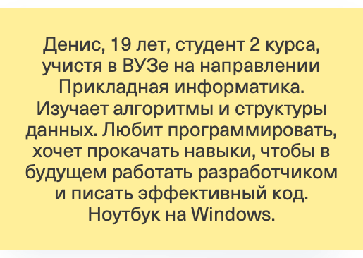
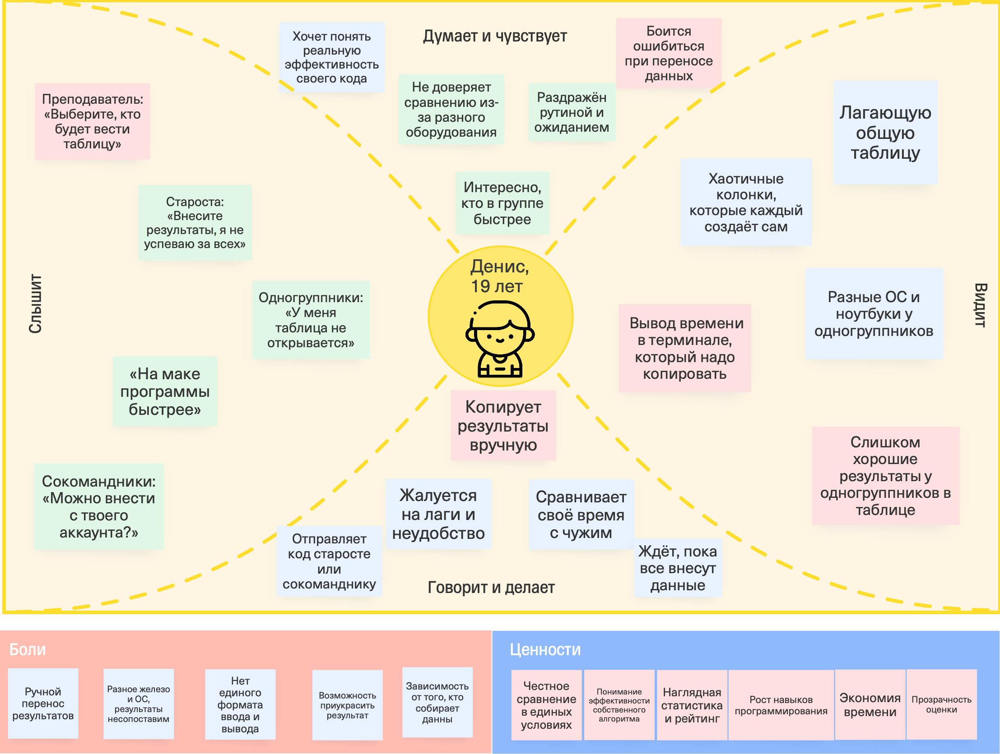
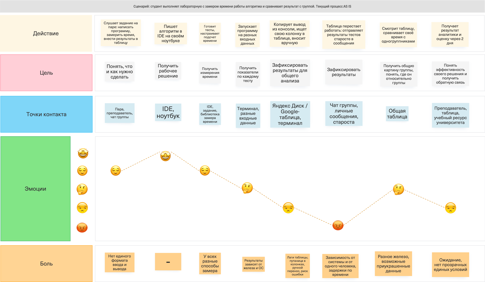

# Анализ целевой аудитории

## Живой разговор с целевой аудиторий

**Михаил Анатольевич** во время дисциплины структуры и алгоритмы компьютерной обработки данных (СИАКОД): Выберите человека, который будет заниматься созданием таблицы. Хорошая идея - создать проект, который решает эти неудобства.

**Староста, Чегодаева Таисия:** Я создавала таблицу в Яндекс Диске, который не выдерживал наплыва всех студентов. Каждый должен был вносить свои данные по результатам выполнения программы, из-за этого таблица лагала. Мне приходилось записывать результаты наших одногруппников вместо них.

**Гаврилов Платон:** Я создал программу, которая принимала на вход чужие программы и прогоняла в них заранее заданные тестовые сценарии, а затем самостоятельно проводил анализ полученных результатов. Сами программы одногруппники мне отправляли в личные сообщения. Результаты по времени выводились в консоли, затем приходилось их копировать и вносить в таблицу. Было очень неудобно тестировать чужие программы, так как не все следовали единому стандарту оформления и входных/выходных данных. По какой-то причине расчет времени в моем коде был не очень точным, из-за чего оценка была необъективной.

**Семен Овчар:** Помню неполадки с интернетом. Кажется, что некоторые ребята приукрашивали свои результаты для хорошего анализа.

**Хрячкова Яна:** Мы подключали библиотеку для подсчета времени, программы тестировали на компьютерах с разными операционными системами. Кажется, что на macOS программы были быстрее и это было заметно при чтении таблицы. Накладывалась ответственность на человека, который собирал результаты, так как нужно было подождать, пока все внесут результаты своих программ.

**Петросян Гор:** нужно было вносить все в таблицу, делиться по командам внутри группы. Мои сокомандники вводили все с одного аккаунта, так как таблица работала не у всех.

**Аназарова Наила:** Приходилось копировать вывод программы после каждого прогона из терминала и вставлять в таблицу. В самой таблице была путаница, каждый сам создавал колонку для своих результатов.

## Карта эмпатии

Чтобы систематизировать наблюдения, использована карта эмпатии. Она показывает, что пользователь говорит, думает, делает и чувствует, и помогает увидеть проблемы, которые сам он не всегда формулирует прямо.

Карта эмпатии фиксирует состояние пользователя в целом: его мысли, слова, действия и чувства. Она не показывает, в какой момент процесса они возникают. Чтобы это выяснить, на её основе построена карта пути пользователя (Customer Journey Map, CJM). CJM раскладывает сценарий по шагам и позволяет найти этапы, где пользователю хуже всего и где потребность в решении наиболее острая.

## Customer Journey Map

Ниже показан текущий процесс (as-is) без BenchCode.

Сценарий: студент выполняет лабораторную работу с замером времени выполнения алгоритма и сравнивает результат с группой.

Для каждого этапа указаны действие, цель, точки контакта, эмоции и боль. Колонка «Боль» нужна для трассировки: каждая боль позже связывается с требованием.

Анализ пути показывает, что эмоциональное состояние пользователя ухудшается по мере приближения к результату. На первых этапах (получение задания, написание программы) преобладают спокойный интерес и азарт, то есть сама учебная задача мотивирует. Проблемы начинаются на этапе измерений и нарастают дальше.

**Главная точка просадки: этап 5 и 6, "Копирует вывод из консоли и работает с таблицей", "Таблица перестает работать, отправляет результаты тестов старосте в сообщения".** Здесь студент вручную копирует вывод из консоли в общую таблицу, ищет свою колонку и рискует ошибиться при переносе. Таблица при этом лагает или перестаёт открываться, и он вынужден писать старосте и отправлять результаты через него. Это самая низкая эмоциональная точка: пользователь тратит время не на анализ алгоритма, а на обход недостатков инструмента.

**Вторичные точки просадки:**

- **Этапы 3–4 (замер и прогон).** У каждого свой способ замера времени, а результаты зависят от железа и ОС. Студент не уверен в точности собственных данных.
- **Этап 6 (ожидание).** Общий результат зависит от одного человека, поэтому сроки сдвигаются.
- **Этап 7 (сравнение).** Данные разных студентов несопоставимы, а часть результатов может быть приукрашена, поэтому доверие к сравнению падает.
- **Этап 8 (итог).** Студент тревожится, справедливо ли его оценят.

Итоговая картина складывается из четырёх групп проблем:

1. **Ручной труд и ненадёжный инструмент.** Копирование вывода, лаги таблицы, путаница в колонках.
2. **Несопоставимость результатов.** Разное железо, ОС и способы замера.
3. **Недоверие и отсутствие прозрачности.** Возможность приукрасить результат, нет единых условий.
4. **Зависимость от посредника.** Староста собирает данные и тем самым становится узким местом процесса.

Выявленные точки боли служат исходными данными для следующего этапа: определения потребностей и требований пользователей. По ним формируются пользовательские истории (User Story), функциональные и нефункциональные требования к системе и сценарии использования (Use Case). Для каждой боли будет прослежена связь с требованием, чтобы ни одно требование не появлялось без основания в исследовании пользователей.

**POV (Point of View / Точка зрения):**

> **Пользователь:** Студент 2–3 курса, сдающий лабораторные работы по алгоритмам.
>
> **Потребность:** Иметь объективную и воспроизводимую оценку эффективности своего кода (время/память) без сбоев.
>
> **Инсайт:** Студенты боятся просесть в рейтинге из-за того, что их компьютер затормозил во время замеров, а ручной перенос результатов в гугл-таблицы приводит к постоянным ошибкам и лишней переписке со старостой.

**HMW (How Might We / Как мы можем...?):**

1. *Как мы можем* автоматизировать прогон решений на едином железе, чтобы исключить фактор мощности компьютера студента?

   1. *Как мы можем* вычислять медианные значения времени и памяти, чтобы устранить случайные флуктуации ОС при единичном запуске?
   2. *Как мы можем* автоматически формировать сводную таблицу (Leaderboard) по группам, чтобы освободить преподавателя и старосту от ручной рутины?

ГОСТ Р ИСО 9241-210: после понимания пользователей и контекста следующим видом деятельности является определение потребностей и требований пользователей, затем - проектные решения и их оценка.

<https://habr.com/ru/companies/alfa/articles/818855/>
