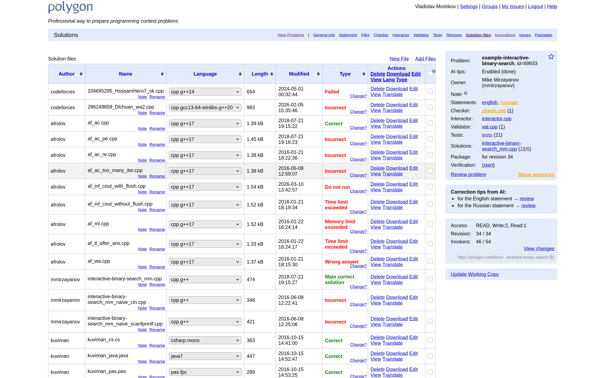
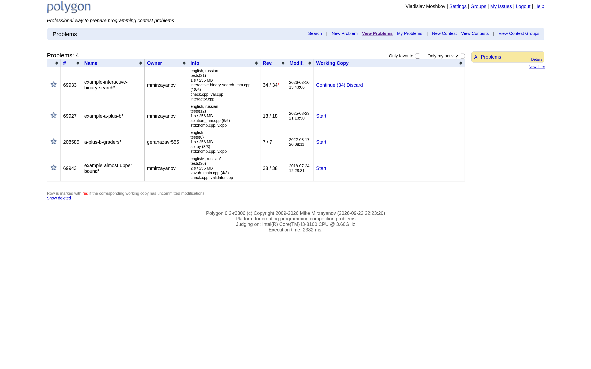
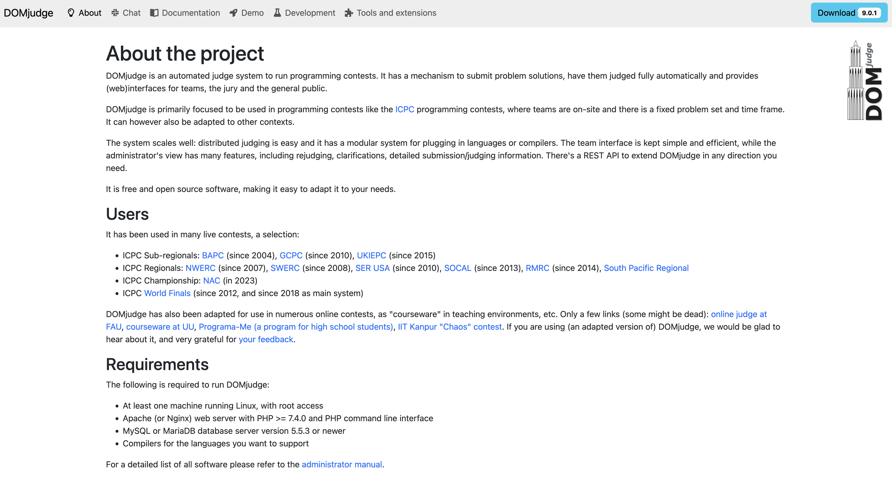
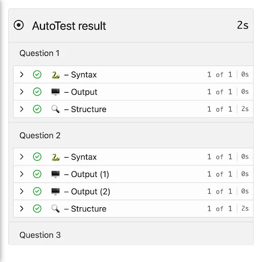
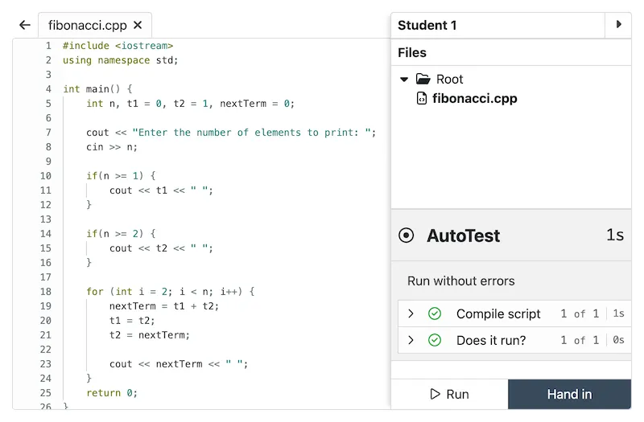

# Анализ конкурентов

для учебно-аналитической платформы BenchCode

Дата актуализации: 1 октября 2026 года

| **Основной вывод.** Рынок уже насыщен платформами для автоматической проверки программ и проведения контестов, однако BenchCode отличается фокусом не только на вердикте «принято/не принято», а на накоплении и сравнении измеримых характеристик выполнения решений. Наиболее близкие аналоги по отдельным функциям — Eolymp, CodeGrade, DOMjudge, CMS и Polygon; при этом каждый из них решает только часть исходной задачи BenchCode или делает акцент на другой сценарий использования. |
| --- |

1. Позиционирование BenchCode относительно конкурентов

BenchCode находится на пересечении трёх классов систем: автоматических проверяющих (online judges), платформ для проведения соревнований и образовательных автогрейдеров. Поэтому прямого аналога «один в один» найти сложно: разные продукты оптимизированы либо под спортивное программирование, либо под проведение экзаменов и найм, либо под полноценный онлайн-курс.

С точки зрения продукта наиболее существенная особенность BenchCode — связка «автоматическая проверка + единая среда выполнения + накопление результатов + сравнительная аналитика». В текущей концепции преподаватель может использовать систему и как инструмент индивидуальной практики, и как инфраструктуру соревнований. Это позволяет не привязывать платформу исключительно к соревновательному режиму.

Важный потенциальный барьер для конкурентов — именно слой аналитики. Если обычный online judge отвечает прежде всего на вопрос «корректно ли решение?», BenchCode добавляет вопросы «сколько времени оно работало?», «сколько памяти потребляло?», «как результаты меняются между запусками и студентами?», «как решение выглядит относительно группы?». Это и следует раскрывать как центральное отличие продукта.

2. Прямые и ближайшие конкуренты

## Polygon (Codeforces)

**Фокус:** Инфраструктура подготовки задач и тестов для соревнований.

**Что уже умеет:** Редактор условия, генерация тестов, модельные решения, автоматическая проверка и валидация; поддерживается API.

**Ограничение относительно BenchCode:** Сильный набор инструментов для постановщика задач, но не образовательная аналитическая платформа для преподавателя и группы студентов. Основной сценарий — подготовка конкурсных задач и пакетов.

**Что стоит учесть:** BenchCode может ориентироваться на качество автоматической проверки Polygon, но строить следующий слой: история запусков, сравнение метрик и учебная аналитика.

## DOMjudge

**Фокус:** Автоматическое судейство программных соревнований.

**Что уже умеет:** Приём решений, компиляция, запуск, автоматическое сравнение с эталоном, таблица результатов, интерфейсы команды/жюри/публичного просмотра, REST API; проект open source.

**Ограничение относительно BenchCode:** Продукт прежде всего рассчитан на contests в формате ICPC, а не на исследование эффективности решений в учебном процессе.

**Что стоит учесть:** Для BenchCode это пример зрелой contest-инфраструктуры. Отличие — переход от управления соревнованием к накоплению и интерпретации эксплуатационных метрик.

## CMS (Contest Management System)

**Фокус:** Open-source система проведения олимпиад и соревнований.

**Что уже умеет:** Контесты, отправки, рейтинг, детальная настройка обратной связи, песочницы, собственные языки и плагины, разные типы задач и системы подсчёта баллов.

**Ограничение относительно BenchCode:** Фокус на контестной инфраструктуре и администрировании, а не на учебной аналитике результатов исполнения по студентам и группам.

**Что стоит учесть:** BenchCode может взять идею гибкой системы задач и тестирования, но сделать интерфейс и модель данных удобнее для преподавателя.

## CodeGrade

**Фокус:** Автопроверка программных заданий для учебных курсов.

**Что уже умеет:** Автогрейдер, браузерный редактор, мгновенная обратная связь, рубрики, inline-комментарии, API, интеграции с LMS; заявлена поддержка 175+ языков.

**Ограничение относительно BenchCode:** Сильнее выражен сценарий «курс → задание → оценивание → обратная связь», а не конкурсное сравнение решений и анализ эксплуатационных характеристик программы как отдельного аналитического объекта.

**Что стоит учесть:** Это важный ориентир по UX преподавателя и автоматическому оцениванию. BenchCode может сосредоточиться на соревнованиях, метриках выполнения и сравнении студентов.

## Codio

**Фокус:** Учебная среда с автооцениванием программных заданий.

**Что уже умеет:** Кодовые тесты, расширенные тесты, ручная и автоматическая оценка, рубрики, обратная связь внутри кода, аналитика результатов и работа в учебных курсах.

**Ограничение относительно BenchCode:** Широкая образовательная среда, но не специализированный продукт для сравнительного анализа эффективности алгоритмических решений и контестов.

**Что стоит учесть:** Полезный ориентир для организации учебного цикла. BenchCode может быть уже по функционалу, но глубже именно в сравнительной аналитике выполнения.

## HackerRank

**Фокус:** Платформа технического тестирования и соревнований, в первую очередь для найма и оценки навыков.

**Что уже умеет:** Кастомные coding questions, тесты, sandbox-среды, собственные конкурсы, библиотека заданий, отчёты и аналитика.

**Ограничение относительно BenchCode:** Основная целевая аудитория — компании и кандидаты; сценарий преподаватель → учебная группа не является ядром продукта.

**Что стоит учесть:** Подтверждает востребованность кастомных тестов, автоматической проверки и отчётности, но оставляет пространство для учебно-ориентированного продукта.

## Yandex Contest

**Фокус:** Проведение тренировочных, закрытых и соревновательных контестов.

**Что уже умеет:** Есть открытые и закрытые контесты, виртуальный формат, а также режимы без жёсткого ограничения времени для тренировочных курсов, экзаменов и подобных сценариев.

**Ограничение относительно BenchCode:** Сильный инструмент проведения соревнований, но концепция BenchCode дополнительно требует многомерной статистики по исполнению решений и сравнительного анализа на уровне учебной группы.

**Что стоит учесть:** Полезен как локальный ориентир по contest UX и сценариям закрытых учебных соревнований.

## Stepik

**Фокус:** Платформа онлайн-курсов и учебных заданий.

**Что уже умеет:** Создание курсов и уроков, задания, обучение и публикация. Приватный режим курсов существует в справке только для клиентов с действующим старым Enterprise; тариф Enterprise отменён в мае 2023 года.

**Ограничение относительно BenchCode:** Не является специализированным движком для глубокого анализа исполнения программ или соревнований между решениями.

**Что стоит учесть:** BenchCode может позиционироваться не как «ещё один курс», а как инфраструктура практического программирования, которую можно встроить в учебный процесс.

## Codewars

**Фокус:** Платформа регулярной практики через небольшие программные задачи.

**Что уже умеет:** Пользователи могут создавать собственные kata после получения соответствующего уровня привилегий; есть активная система практики и сообщество авторов.

**Ограничение относительно BenchCode:** Сценарий построен вокруг community-практики, а не вокруг закрытого курса преподавателя, единой среды исполнения и статистики по учебной группе.

**Что стоит учесть:** Хороший ориентир для будущей механики коротких соревнований и регулярных тренировок, но не прямой аналог преподавательской аналитики.

3. Сравнительная матрица возможностей

Матрица ниже не является рейтингом продуктов. Она показывает, на каких функциях и сценариях делается основной акцент в официальных материалах платформ по состоянию на 1 октября 2026 года.

| **Платформа** | **Автопроверка** | **Свои задачи/тесты** | **Приватные группы/контесты** | **Contest-режим** | **Учебная аналитика** | **Метрики времени/памяти как ядро** |
| --- | --- | --- | --- | --- | --- | --- |
| BenchCode | Да | Да | Да, по концепции | Да | Да, по концепции | Да |
| Polygon | Да | Да | Частично / через contest tooling | Да | Не ядро | Не ядро |
| DOMjudge | Да | Да | Да | Да | Админ. и contest-статистика | Не ядро |
| CMS | Да | Да | Да | Да | Contest-ориентировано | Не ядро |
| Eolymp | Да | Да | Да | Да | Есть учебные сценарии | Не ядро |
| CodeGrade | Да | Да | Да, в рамках курсов/LMS | Не ядро | Да | Не ядро |
| Codio | Да | Да | Да, в курсах | Не ядро | Да | Не ядро |
| HackerRank | Да | Да | Да | Да | Не ядро | Не ядро |
| Yandex Contest | Да | Да | Да | Да | Частично | Не ядро |
| Stepik | Да, для программных заданий | Да | Ограниченно; приватность курса связана со старым Enterprise | Не ядро | Да, как часть курса | Не ядро |
| Codewars | Да | Да, через kata | Сообщество/тренировки | Есть соревновательные механики | Не ядро | Не ядро |

4. Где у BenchCode есть понятная точка отличия

**1) Аналитика выполнения, а не только вердикт**

Для большинства online judges метрики времени и памяти являются прежде всего ограничениями или частью judging. У BenchCode они должны стать самостоятельными объектами анализа: графики по запускам, средние и медианные значения, выбросы, динамика между версиями программы, сравнение с группой.

**2) Единая среда как условие сопоставимости**

Концепция BenchCode прямо связывает централизованный запуск с уменьшением влияния различий в компьютерах студентов. Это позволяет перейти от «у меня на ноутбуке работало 0,4 секунды» к сопоставимым результатам, полученным в одной вычислительной среде.

**3) Две логики использования в одном продукте**

Обычная проверка решения и соревнование не требуют разных систем. В BenchCode индивидуальный режим может собирать историю экспериментов студента, а contest-режим — использовать ту же инфраструктуру для массового запуска и сравнения решений.

**4) Аналитика на нескольких уровнях**

Сильной частью концепции является иерархия «запуск → решение → студент → группа → поток → соревнование → задача». Это можно превратить в отдельную модель данных и интерфейс преподавателя, где один и тот же результат используется и для обратной связи студенту, и для анализа учебной группы.

**5) Короткие соревнования как механизм вовлечения**

Идею форматов 1-на-1, коротких дуэлей и небольших раундов можно оставить в перспективе. Она логично продолжает соревновательную составляющую, но не должна подменять основную ценность продукта — учебную практику и аналитику.

5. Идеи из публичного пользовательского опыта

В одном из публичных материалов о спортивном программировании автор описывает контесты не только как способ проверить знания, но и как регулярную практику, которая помогает видеть собственный текущий уровень, возвращаться к нерешённым задачам и развивать аналитический подход. Отдельно подчёркивается эффект ограниченного времени: участнику приходится самостоятельно выбирать стратегию, отказываться от неработающих гипотез и принимать решения без заранее указанного алгоритма.

Для BenchCode из этого следуют три продуктовые идеи. Во-первых, результат проверки лучше показывать как историю прогресса, а не как одиночный вердикт. Во-вторых, полезны короткие тренировочные раунды, которые создают регулярную привычку практиковаться. В-третьих, рейтинг можно использовать осторожно: ценность для обучения может быть не только в позиции относительно других, но и в динамике собственного результата, стабильности решения и сравнении с предыдущими попытками.

| **Практический вывод для BenchCode:** аналитика должна помогать студенту ответить не только «прошёл ли тест?», но и «стал ли мой алгоритм лучше по сравнению с прошлой версией и на фоне типичных результатов группы?» |
| --- |

6. SWOT-ориентированная оценка конкурентной позиции

| **Сильные стороны**  Единая среда запуска; автоматический сбор метрик; индивидуальный и contest-режимы; анализ на уровне студента и группы; возможность строить историю экспериментов. | **Слабые стороны**  Пока нет большого банка учебных задач, зрелой экосистемы и длительно накопленной статистики. Потребуются качественные sandbox-механизмы, система тестов и понятный UX преподавателя. |
| --- | --- |
| **Возможности**  Короткие соревнования; интеграция с LMS; экспорт аналитики; сравнение версий решений; рекомендации на основе статистики; позднее — ИИ-анализ кода и результатов. | **Угрозы**  Крупные платформы могут расширить образовательные сценарии, а open-source системы можно развернуть самостоятельно. Поэтому дифференциацию нужно строить не на самом факте автопроверки, а на аналитике, учебном сценарии и удобстве использования. |

7. Что следует показать в продукте, чтобы BenchCode не выглядел «ещё одним online judge»

- Карточка решения: вердикт, время, память, CPU/доступные системные показатели, количество тестов, история запусков и сравнение с предыдущей версией.
- Панель студента: прогресс по задачам, динамика метрик, стабильность решений, средние значения и сравнение с группой без перегрузки интерфейса рейтингами.
- Панель преподавателя: сводка по группе, распределение результатов, проблемные задачи, выбросы, сравнение решений и выгрузка данных.
- Contest Dashboard: единые условия запуска, таблица результатов, возможность скрыть графики и аналитические детали от участников до окончания соревнования, а после конкурса — открыть расширенный разбор.
- История экспериментов: возможность запускать несколько реализаций одного алгоритма на одном наборе тестов и сравнивать их напрямую. Именно этот сценарий особенно хорошо раскрывает учебную ценность BenchCode.

8. Итог

Конкурентный анализ показывает, что техническую базу для автоматической проверки программ уже хорошо закрывают зрелые решения. Поэтому уникальность BenchCode целесообразно строить не вокруг самой функции «скомпилировать и проверить код», а вокруг следующего уровня — измерить выполнение в одинаковых условиях, накопить историю, агрегировать её и сделать понятной для студента и преподавателя.

Наиболее важные ориентиры распределяются по ролям: Polygon — качество подготовки задач и тестов; DOMjudge и CMS — зрелость contest-инфраструктуры; Eolymp — сочетание учебных пространств и соревнований; CodeGrade и Codio — UX образовательного автогрейдера и обратной связи; HackerRank — гибкая оценочная инфраструктура; Yandex Contest — закрытые и тренировочные соревнования; Stepik — интеграция практики в курс; Codewars — регулярная микро-практика и авторство пользовательских заданий.

Таким образом, BenchCode может занять нишу «учебной лаборатории для сравнительного анализа программных решений»: студент получает автоматическую проверку и историю экспериментов, преподаватель — единую среду выполнения и агрегированную статистику, а соревнование становится одним из режимов работы с теми же данными, а не отдельным продуктом.

Источники и ссылки

[1] Polygon — официальная страница платформы. <https://polygon.codeforces.com/>

[2] DOMjudge — About / Documentation. <https://www.domjudge.org/about>

[3] CMS — официальный репозиторий и описание возможностей. <https://github.com/cms-dev/cms>

[4] CodeGrade — Autograder for Programming Courses. <https://www.codegrade.com/landing/main>

[5] Codio — Automated Grading & Instant Learner Feedback. <https://www.codio.com/features/auto-grading>

[6] HackerRank — FAQ / создание собственных контестов и кастомных заданий. <https://www.hackerrank.com/faq/>

[7] Yandex Contest — типы и доступ к контестам. <https://official.contest.yandex.ru/docs/en/contest>

[8] Stepik — справка по приватным курсам. <https://help.stepik.org/article/54745>

[9] Codewars — документация по созданию kata и привилегиям. <https://docs.codewars.com/authoring/tutorials/create-first-kata/>

[11] Публичный материал о влиянии контестов на обучение, регулярную практику и аналитическое мышление. <https://habr.com/ru/articles/1002430/>

Примечание: характеристики конкурентов приведены по официальным материалам, доступным на дату 01.10.2026. Формулировки «не ядро» означают, что соответствующая функция не является центральной частью позиционирования продукта в рассмотренных материалах, а не утверждение об абсолютном отсутствии такой функции.
