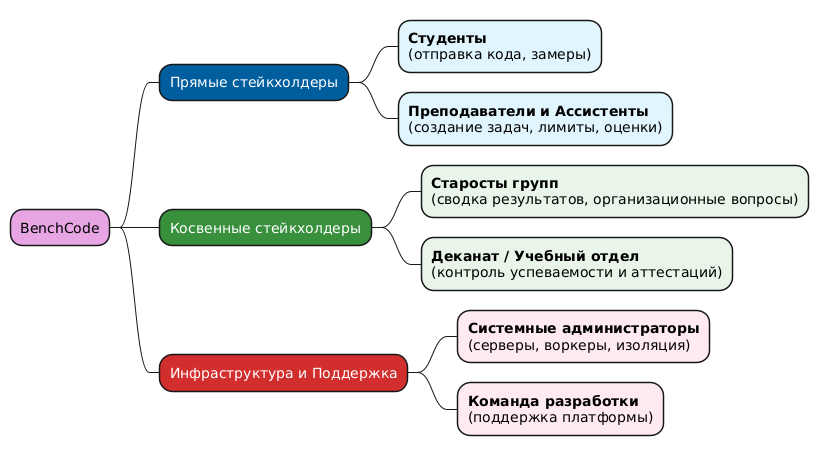

# Концепция и границы проекта BenchCode

**Команда:**

Цыбенко Александра - менеджер проекта

Берсеков Айдамир - главный тестировщик

Владислав Мошков - архитектор

**BenchCode** — учебно-аналитическая веб-платформа для автоматизированной проверки, измерения и сравнительного анализа программных решений в рамках обучения алгоритмизации и программированию.

### **Проблема**

При практической работе с алгоритмами студенту необходимо оценивать не только корректность программы, но и эффективность её реализации. Для этого результаты запусков на разных входных данных приходится фиксировать и сравнивать вручную, например в Excel. При большом количестве запусков это увеличивает объём рутинной работы и вероятность ошибок.

Дополнительная проблема возникает при сравнении программ, запущенных на разных компьютерах: различия в аппаратных ресурсах могут влиять на время выполнения и другие показатели. При проведении конкурса программ преподавателю необходимо обеспечить единые условия тестирования и сопоставить результаты большого количества решений.

BenchCode автоматизирует сбор и обработку результатов выполнения программ.

### **Концепция решения**

Студент отправляет программу в BenchCode, после чего система автоматически запускает её на заданных тестовых данных, проверяет корректность и фиксирует характеристики выполнения: время, использование процессора, потребление памяти и другие доступные показатели.

Результаты каждого запуска сохраняются в системе. Это позволяет отказаться от ручного переноса данных и использовать накопленную статистику для анализа отдельного решения, студента или группы.

Платформа поддерживает два режима работы:

- **индивидуальная работа** — отправка программы вне конкурса для проверки и анализа её характеристик;
- **соревнование программ** — преподаватель задаёт условия конкурса, после чего решения участников выполняются на единых тестовых данных и автоматически сравниваются по определённым показателям.

Централизованное выполнение программ в единой среде делает результаты более сопоставимыми, чем при самостоятельном запуске программ на компьютерах студентов.

### **Алгоритмическая составляющая**

Алгоритмическая составляющая BenchCode заключается в **сборе, обработке, агрегации и сравнении результатов выполнения программ**.

Система формирует статистику на разных уровнях:

- отдельный запуск;
- программное решение;
- студент;
- учебная группа;
- поток;
- участники соревнования;
- отдельная задача.

Для выбранной совокупности система может рассчитывать средние значения показателей и сопоставлять с ними результаты конкретного студента или решения. На основе накопленных данных формируются сравнительные таблицы и рейтинги.

### **Ценность**

**Для студента** BenchCode сокращает ручную работу при исследовании программных решений: результаты запусков сохраняются автоматически, а показатели можно сравнивать без ведения отдельных таблиц. При индивидуальной работе это позволяет использовать платформу для оценки эффективности реализации алгоритмов.

**Для преподавателя** система автоматизирует проверку и сбор статистики по студентам. При проведении соревнования все решения тестируются в единых условиях, после чего преподаватель получает готовые результаты сравнения.

**Для учебного процесса** платформа позволяет оценивать программные решения не только по корректности, но и по эффективности, используя единый набор измеряемых показателей.

### **Перспективное развитие**

В дальнейшем планируется возможность интеграции ИИ-модуля, который сможет анализировать исходный код и результаты его выполнения, подсвечивать потенциальные ошибки и проблемные участки, а также формировать рекомендации по улучшению решения.

ИИ рассматривается как дополнительный аналитический компонент и не заменяет автоматическую проверку и измерение характеристик программы.

**Текущие альтернативы:**

| Решение | Что предлагают | Почему этого недостаточно |
| --- | --- | --- |
| **Google Таблицы / Excel** | Ручной ввод времени и памяти студентами. | Высокий риск ошибок, несопоставимость замеров с разных ПК, таблицы ломаются при одновременном редактировании. |
| **Yandex.Contest / Codeforces** | Автоматическая проверка задач (Pass/Fail) на платформах спортивного программирования. | Фокусируются только на бинарной вердиктной проверке тестов, не дают медианной аналитики расходования ресурсов по группам и неудобны для гибких вузовских лабораторных. |
| **Moodle VPL / DOMjudge** | Плагины для тестирования кода внутри LMS-систем. | Сложная развертка, перегруженный интерфейс, отсутствуют удобные инструменты проведения быстрого соревнования без долгих настроек аккаунтов. |

### Целевая аудитория

**Сегменты аудитории:**

- **Студенты IT-специальностей (17–23 года):**

  - Студенты 1–3 курсов, изучающие дисциплины «Алгоритмы и структуры данных», «СИАКОД», «Программирование». Хотят быстро проверить код, увидеть медианные метрики выполнения и узнать свое место в рейтинге группы.
- **Преподаватели и Ассистенты кафедр:**

  - Преподаватели, ведущие практические и лабораторные занятия. Хотят легко создавать соревнования, задавать тесты, не тратить время на авторизационную рутину и за пару кликов видеть полную ведомость посылок.
- **Старосты учебных групп:**

  - Студенты, выполняющие организаторскую роль. Хотят избавиться от ручного сведения Google-таблиц и сверок результатов.

**Потребности и ожидания:**

- **Студенты:** Быстрый ввод кода, моментальный прогон в изоляции, объективные медианные метрики без зависаний собственного ПК.
- **Преподаватели:** Быстрое создание контеста за 2 минуты (с паролем доступа), загрузка тестов, автоматическая сборка рейтинга.

### Mindmap стейкхолдеров

### **Ключевые функции по типам пользователей:**

- **Тип пользователя 1: Студент**

  - Переход в режим «Студент» на главной странице.
  - Вход в соревнование по короткому коду.
  - Просмотр карточек задач, условий (Markdown) и публичных тестов.
  - Ввод ФИО, выбор языка программирования и отправка решения на проверку.
  - Просмотр результатов прогона (память, время) и общего Leaderboard.
- **Тип пользователя 2: Преподаватель**

  - Переход в режим «Преподаватель» и создание нового соревнования (с заведением мастер-пароля).
  - Получение автоматически сгенерированного кода соревнования.
  - Добавление задач, условий, установление лимитов и загрузка входных/выходных файлов тестов.
  - Авторизация в созданном соревновании по мастер-паролю для доступа к просмотру полной таблицы всех посылок студентов.
- **Тип пользователя 3: Изолированный Воркер (Система)**

  - Автоматический прием кода, сборка Docker-контейнера с ограничением CPU/RAM, прогон тестов, вычисление медианных параметров, уничтожение контейнера.

### Риски и стратегии их минимизации

| № | Описание риска | Тип риска | Вероятность / Влияние | Стратегия минимизации и предотвращения | Реакция при наступлении (Fallback) |
| --- | --- | --- | --- | --- | --- |
| **1** | Низкая вовлеченность и сопротивление преподавателей внедрению | Бизнес / Организационный | Средняя | Максимальное упрощение UX: проведение контеста за 2 минуты, вход без регистрации по мастер-паролю | Проведение персональных демонстраций, предоставление готовых шаблонов соревнований и тестов. |
| **2** | Отклонение результатов из-за саботажа или обхода системы пользователями | Бизнес / Продуктовый | Средняя / Высокое | Использование медианных показателей по N запускам, жесткая валидация входных/выходных тестов и формата данных. | Ручной разбор спорных посылок через реестр всех сохраненных логов и вывода программы. |
| **3** | Превышение допустимых лимитов бесплатной инфраструктуры (S3 / VPS) | Бизнес / Финансовый | Средняя / Среднее | Оптимизация хранения файлов тестов (сжатие, чистка старых логов), жесткие лимиты на размер загружаемого кода. | Временная архивация устаревших соревнований, перенос хранения на локальные диски воркера. |
| **4** | Зависание сервера из-за бесконечных циклов (while true) | Технический | Высокая / Критическое | Настройка жестких таймаутов на уровне Docker CLI | Принудительное завершение процесса воркером, присвоение вердикта Time Limit Exceeded. |
| **5** | Выполнение вредоносного кода (Escape из Docker / Взлом ФС) | Технический / Безопасность | Средняя / Критическое | Запуск контейнера от non-root пользователя, отключение сети (--network none), ограничение системных вызовов через seccomp. | Мгновенный бан сессии/IP, сброс контейнера, автоматическое уведомление администратора. |
| **6** | Срыв сроков релиза из-за переусложнения функций (Scope Creep) | Организационный | Средняя / Критическое | Отказ от глобальной авторизации в MVP v1.0; приоритизация бэклога строго по методологии MoSCoW. | Отсечение всех функций категорий Should/Could Have |

## Границы и ограничения

### 7. Основные функции продукта (MoSCoW-приоритизация)

**M - Must have (Обязательно для MVP v1.0):**

- Разделение интерфейса на главном экране (Студент / Преподаватель).
- Вход студента в соревнование по уникальному коду.
- Ввод ФИО и отправка кода программы.
- Создание соревнования преподавателем с заданием мастер-пароля и автогенерацией кода.
- Создание задач (Markdown-условие, выбор типа проверки, загрузка тестов).
- Изолированный прогон кода в Docker-контейнере и расчет медиан замеров.
- Сводный Leaderboard участников по результатам соревнований.
- Просмотр преподавателем всех сохраненных посылок по мастер-паролю.

**S - Should have (Желательно в ближайших обновлениях):**

- Фильтрация таблицы лидеров по конкретным учебным группам.
- Быстрый запуск кода только на публичных тестах без сохранения в общую БД.
- Подсветка синтаксиса кода в редакторе на фронтенде.

**C - Could have (Возможно в будущем):**

- Выгрузка сводной ведомости результатов в формат CSV/Excel.
- Отображение графика расхода памяти по ходу выполнения программы.

**W - Won’t have (Сознательно исключено из MVP v1.0):**

- Полноценная система регистрации и личных кабинетов с Email/OAuth.
- Нативные мобильные приложения (только адаптивный Веб).
- Интеграция с внешней LMS (Moodle, Canvas).
- ИИ-модуль для подсказок по рефакторингу кода.

### 8. Версии продукта и план развития

- **Версия 1.0 - MVP (Текущая версия):**

  - **Цель:** Проверить гипотезу автоматического медианного профилирования в Docker без сложности авторизации.
  - **Срок:** 4 месяца (Сентябрь — Декабрь 2026).
  - **Функционал:** Вся категория *Must Have*.
- **Версия 2.0 - Личные кабинеты и фильтрация:**

  - **Цель:** Повысить удобство работы регулярных групп и преподавателей.
  - **Срок:** 2 месяца после запуска MVP.
  - **Функционал:** Полноценная авторизация (Email/JWT), постоянный личный кабинет преподавателя со списком всех его соревнований, фильтры Leaderboard по группам, экспорт в Excel.
- **Версия 3.0 - Интеллектуальный анализ:**

  - **Цель:** Масштабирование на факультет и внедрение аналитики.
  - **Срок:** 4–6 месяцев после v2.0.
  - **Функционал:** Подключение ИИ-модуля (AI Code Reviewer) для поиска узких мест в коде, поддержка сложных гибридных чекеров, интеграция с Moodle API.

### Ограничения

- **Сроки:** Жесткое ограничение сдачи Этапа 1 и Этапа 2 в рамках учебного семестра РЭУ им. Г. В. Плеханова.
- **Ресурсы команды:** Проект разрабатывается силами 3 человек
- **Технические ограничения:**

  - Веб-приложение выполняется в адаптивном варианте для ПК и ноутбуков.
  - Серверная часть разворачивается на базе Docker/Linux для корректной изоляции системных вызовов (`cgroups`, `namespaces`).
