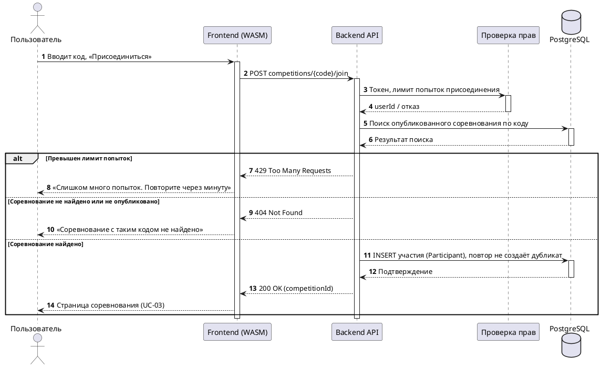
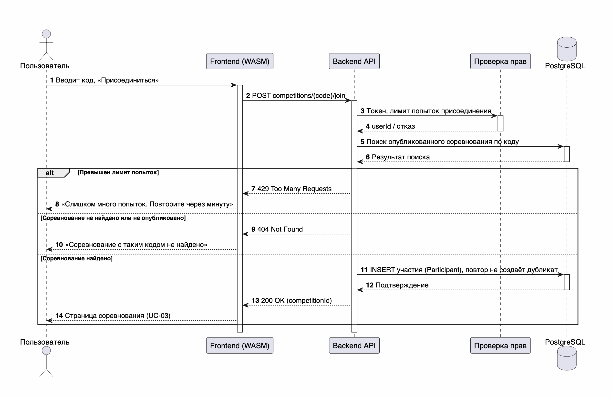
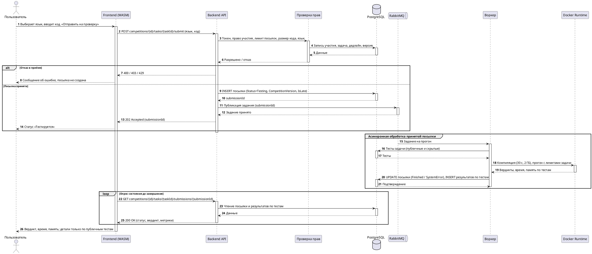
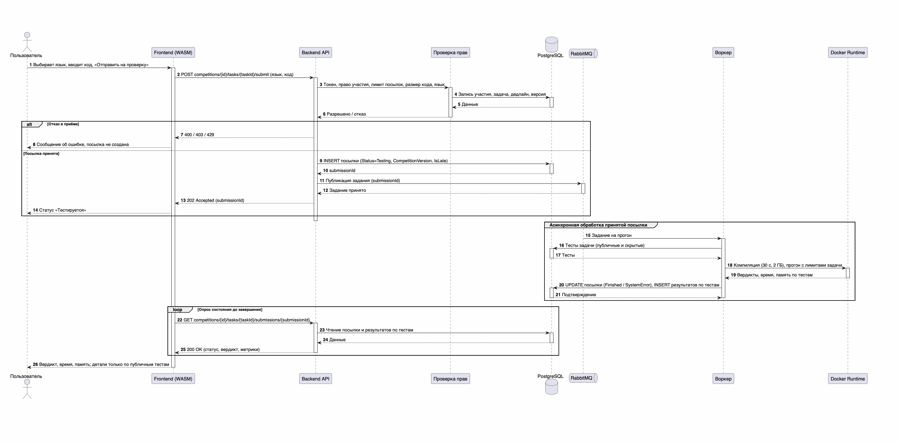
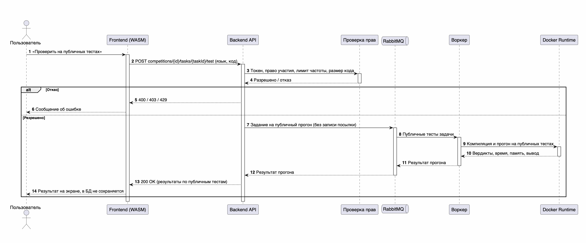
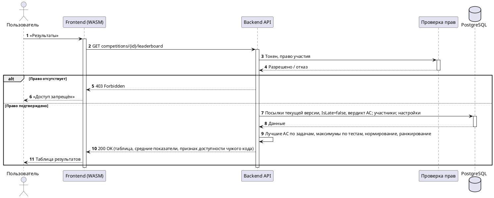
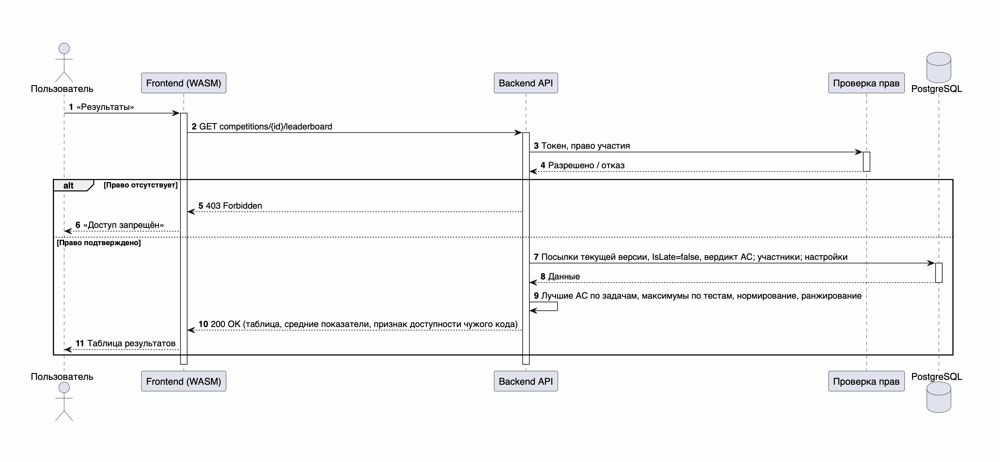
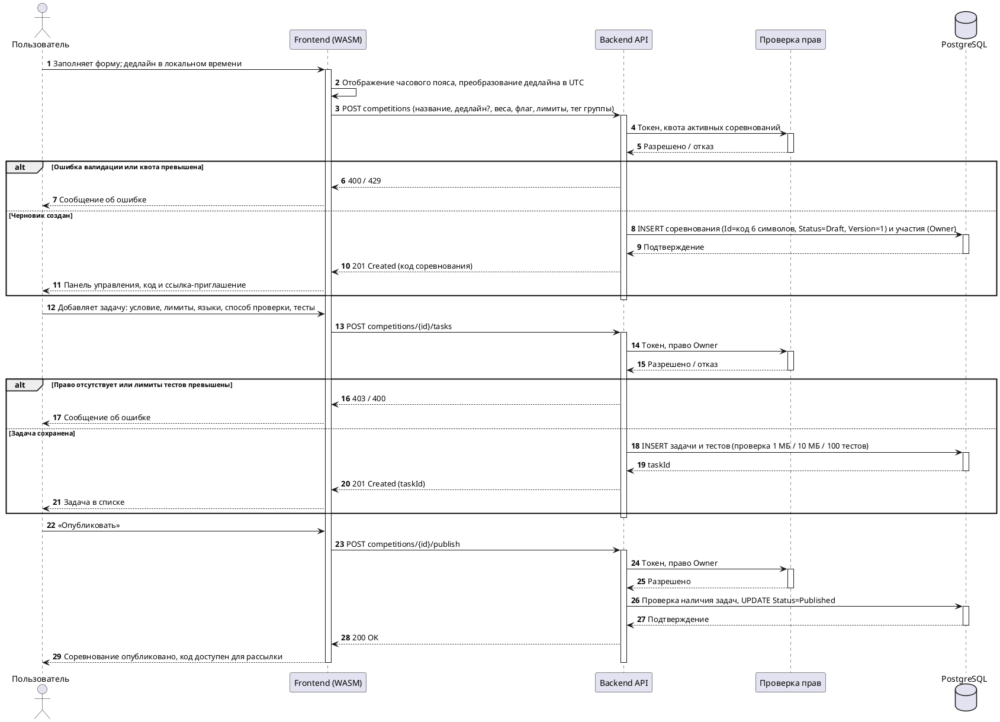
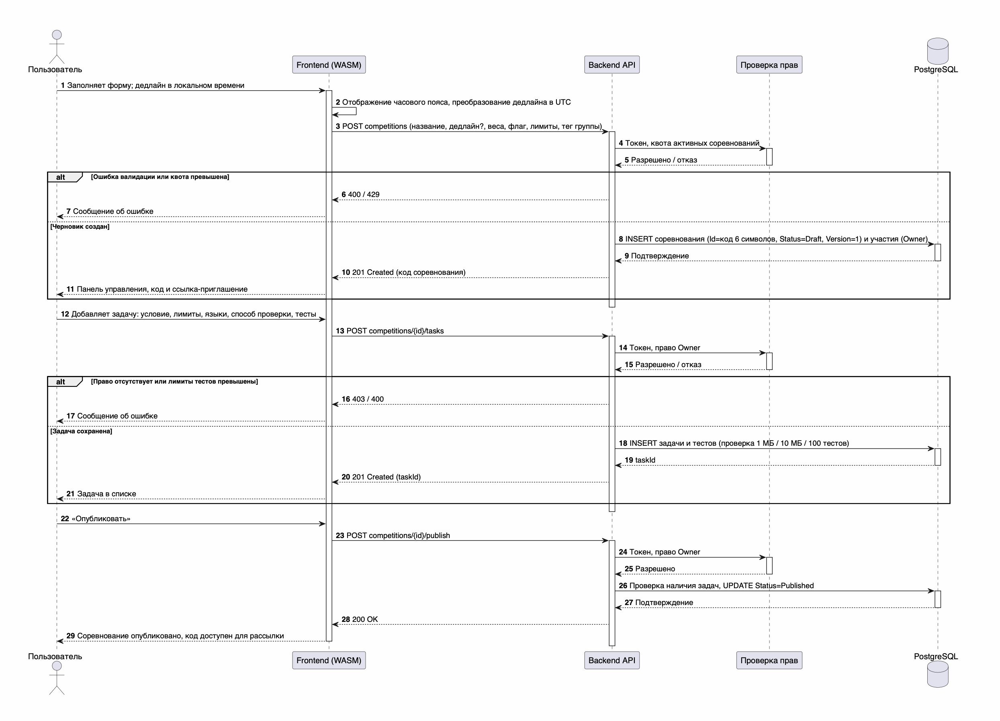

# Выбор проектной среды

**1. Критерии оценки**

Знак «+» означает, что функция хорошо соответствует потребности проекта; «±» — возможность присутствует, но закрывает потребность частично или требует дополнительной настройки; «−» — функция выражена слабо либо её реализация заметно менее удобна для рассматриваемого сценария. 

|  |  |  |  |  |  |
| --- | --- | --- | --- | --- | --- |
| **Критерий** | **Pyrus** | **YouGile** | **Kaiten** | **Яндекс** **Трекер** | **Jira** |
| Постановка и декомпозиция задач | + | + | + | + | + |
| Подзадачи и контроль этапов | + | + | + | + | + |
| Обсуждение непосредственно внутри задачи | + | + | ± | ± | ± |
| Командная коммуникация без отдельного мессенджера | + | + | ± | − | − |
| Аналитика по участникам и загрузке | + | ± | + | + | + |
| Аналитика выполнения проекта | + | + | + | + | + |
| Контроль сроков и просрочек | + | + | + | + | + |
| Документация и база знаний | + | ± | + | − | ± |
| Файлы и материалы внутри рабочего процесса | + | + | + | ± | ± |
| Согласование решений и заданий | + | ± | ± | ± | ± |
| Настраиваемые формы конкурсных заданий | + | ± | + | + | + |
| Настраиваемые маршруты и этапы процесса | + | ± | + | + | + |
| Автоматизация повторяющихся операций | + | + | + | + | + |
| Единый процесс «создать → проверить → согласовать → опубликовать» | + | ± | ± | ± | ± |
| Поиск по задачам, людям и материалам | + | + | + | + | + |
| Наглядное представление текущего состояния | + | + | + | + | + |
| Простота освоения небольшой студенческой командой | + | + | ± | ± | − |
| Соответствие одновременно разработке и организационной части конкурса | + | ± | ± | ± | ± |
| Необходимость дополнительной экосистемы для коммуникаций | − | − | ± | + | + |
| Итоговое соответствие именно нашему сценарию | + | + | ± | **± | **± |

**2. Обоснование оценок**

Pyrus

Pyrus наиболее полно соответствует именно процессной модели нашего проекта. В нём задача одновременно выступает рабочим чатом: в ней можно хранить обсуждение, файлы, ответственного, сроки, подзадачи и согласующих. Система поддерживает настраиваемые формы, маршруты, этапы и статусы, а также отчёты и дашборды. Это позволяет представить конкурсное задание как объект с формализованным жизненным циклом: «создано → подготовлено → проверено → согласовано → опубликовано → завершено». Особенно важны встроенные согласования и возможность менять маршрут процесса без программирования. Таким образом, Pyrus закрывает не только разработку, но и организационную часть конкурса.

YouGile

YouGile является сильным конкурентом по задачам и командному общению: чат доступен непосредственно из задачи, есть планирование, отчёты и автоматизация. Однако при оценке именно конкурсного процесса его возможности согласования и формализации многоэтапной проверки задания выглядят менее выраженными, чем процессная модель Pyrus. Поэтому часть оценок снижена до «±».

Kaiten

Kaiten особенно силён в управлении потоком разработки, Kanban-подходе, аналитике и документации. Для чисто программного проекта это серьёзный вариант. Однако наш проект включает дополнительный слой: подготовку, проверку и согласование конкурсных заданий. Поэтому преимущество Kaiten в управлении потоком разработки не полностью компенсирует менее естественное соответствие процессу «заявка/задание → проверка → согласование → публикация».

Яндекс Трекер

Яндекс Трекер имеет сильные средства разработки: Agile-доски, Гант, проекты, дашборды, отчёты и автоматизации. Но в нашем случае требуется не только контролировать разработческие задачи, но и организовать коммуникацию и согласование конкурсных материалов в едином рабочем процессе. Поэтому оценки по коммуникации и документации снижены.

Jira

Jira предоставляет очень развитый инструментарий управления разработкой, включая Agile-процессы, доски, workflow, отчётность и интеграции. Однако для небольшой студенческой команды её функциональная глубина может быть избыточной относительно организационной задачи проекта. В таблице поэтому снижены оценки по простоте освоения и единому процессу коммуникации и согласования конкурсных материалов.

**3. Почему выбран Pyrus**

Ключевое преимущество Pyrus в рамках данного проекта заключается в сочетании функций управления задачами, коммуникации и автоматизации процессов в одной среде. Для нашего проекта этого достаточно, чтобы описать не только разработку программного продукта, но и жизненный цикл самого конкурсного задания.

·          Единая рабочая сущность. Задача содержит обсуждение, участников, сроки, файлы и историю действий, поэтому часть коммуникации не приходится выносить в отдельный канал.

·          Формализация конкурсных заданий. Через настраиваемую форму можно задать обязательные поля: условие, ограничения, автор, сложность, ответственный проверяющий, дедлайн и статус.

·          Многоэтапная проверка. Маршруты позволяют последовательно или параллельно передавать задачу ответственным участникам и фиксировать прохождение этапов.

·          Документация. База знаний и материалы могут быть связаны с рабочим процессом, что удобно для хранения регламентов конкурса, требований к заданиям и инструкций.

·          Аналитика. Дашборды и отчёты позволяют отслеживать объём и статус задач, просрочки и распределение работы по ответственным.

·          Гибкость. При изменении организации конкурса поля, статусы и маршруты можно адаптировать без необходимости разрабатывать отдельную систему управления проектом.

**5. Практический сценарий использования Pyrus**

1.       Создание задания: автор заполняет форму с условием, ограничениями и параметрами задачи.

2.       Первичная проверка: назначенный участник проверяет корректность формулировки и соответствие требованиям.

3.       Техническая проверка: другой участник проверяет тесты, ограничения и предполагаемое решение.

4.       Согласование: задание передаётся ответственному за финальное утверждение.

5.       Публикация: после согласования статус автоматически меняется на готовый к публикации.

6.       Контроль конкурса: команда отслеживает задания, их статусы, ответственных и сроки через реестры и отчёты.

7.       Разработка сервиса: параллельно в Pyrus ведутся задачи по интерфейсу, серверной части, системе проверки решений, тестированию и документации.

**6. Заключение**

По результатам сравнительного анализа для рассматриваемого проекта выбран Pyrus. Это решение связано не с тем, что Pyrus является универсально лучшей системой управления проектами, а с тем, что его набор возможностей наиболее точно соответствует совокупности требований нашей команды. Jira, Яндекс Трекер и Kaiten обладают сильными средствами управления разработкой и аналитики, а YouGile хорошо сочетает задачи и коммуникацию. Однако Pyrus дополнительно позволяет формализовать процесс подготовки и проверки конкурсных заданий, встроить согласование в маршрут задачи, хранить связанные материалы и получать аналитику по процессу в одной среде.

Таким образом, Pyrus подходит для нашего проекта как единая среда, в которой можно одновременно организовать разработку сервиса и административно-организационную часть конкурса. Это уменьшает количество разрозненных инструментов и делает состояние каждого задания и этапа проекта прозрачным для команды.

## Диаграмма последовательности

**2.1 Присоединение к соревнованию по коду (UC-02)**





**2.2 Полная отправка решения (UC-04, UC-10)**





**2.3 Прогон на публичных тестах (UC-04, альтернативный поток)**

> ```plantuml
>
> @startuml BenchCode_Seq_PublicRun
>
> autonumber
>
> actor "Пользователь" as user
>
> participant "Frontend (WASM)" as site
>
> participant "Backend API" as api
>
> participant "Проверка прав" as authz
>
> queue "RabbitMQ" as mq
>
> participant "Воркер" as worker
>
> participant "Docker Runtime" as docker
>
> user -> site: «Проверить на публичных тестах»
>
> activate site
>
> site -> api: POST competitions/{id}/tasks/{taskId}/test (язык, код)
>
> activate api
>
> api -> authz: Токен, право участия, лимит частоты, размер кода
>
> activate authz
>
> authz --> api: Разрешено / отказ
>
> deactivate authz
>
> alt Отказ
>
> api --> site: 400 / 403 / 429
>
> site --> user: Сообщение об ошибке
>
> else Разрешено
>
> api -> mq: Задание на публичный прогон (без записи посылки)
>
> activate mq
>
> mq -> worker: Публичные тесты задачи
>
> activate worker
>
> worker -> docker: Компиляция и прогон на публичных тестах
>
> activate docker
>
> docker --> worker: Вердикты, время, память, вывод
>
> deactivate docker
>
> worker --> mq: Результат прогона
>
> deactivate worker
>
> mq --> api: Результат прогона
>
> deactivate mq
>
> api --> site: 200 OK (результаты по публичным тестам)
>
> site --> user: Результат на экране, в БД не сохраняется
>
> end
>
> deactivate api
>
> deactivate site
>
> @enduml
>
> ```



## Диаграмма последовательности

**2.1 Присоединение к соревнованию по коду (UC-02)**


**2.2 Полная отправка решения (UC-04, UC-10)**


**2.3 Прогон на публичных тестах (UC-04, альтернативный поток)**

> ```plantuml
>
> @startuml BenchCode_Seq_PublicRun
>
> autonumber
>
> actor "Пользователь" as user
>
> participant "Frontend (WASM)" as site
>
> participant "Backend API" as api
>
> participant "Проверка прав" as authz
>
> queue "RabbitMQ" as mq
>
> participant "Воркер" as worker
>
> participant "Docker Runtime" as docker
>
> user -> site: «Проверить на публичных тестах»
>
> activate site
>
> site -> api: POST competitions/{id}/tasks/{taskId}/test (язык, код)
>
> activate api
>
> api -> authz: Токен, право участия, лимит частоты, размер кода
>
> activate authz
>
> authz --> api: Разрешено / отказ
>
> deactivate authz
>
> alt Отказ
>
> api --> site: 400 / 403 / 429
>
> site --> user: Сообщение об ошибке
>
> else Разрешено
>
> api -> mq: Задание на публичный прогон (без записи посылки)
>
> activate mq
>
> mq -> worker: Публичные тесты задачи
>
> activate worker
>
> worker -> docker: Компиляция и прогон на публичных тестах
>
> activate docker
>
> docker --> worker: Вердикты, время, память, вывод
>
> deactivate docker
>
> worker --> mq: Результат прогона
>
> deactivate worker
>
> mq --> api: Результат прогона
>
> deactivate mq
>
> api --> site: 200 OK (результаты по публичным тестам)
>
> site --> user: Результат на экране, в БД не сохраняется
>
> end
>
> deactivate api
>
> deactivate site
>
> @enduml
>
> ```


**2.4 Таблица результатов (UC-05)**





**2.5 Создание соревнования и задачи (UC-07, UC-08)**




